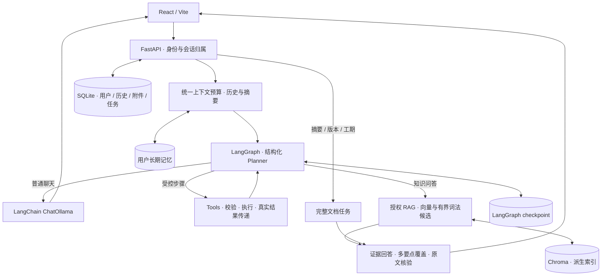
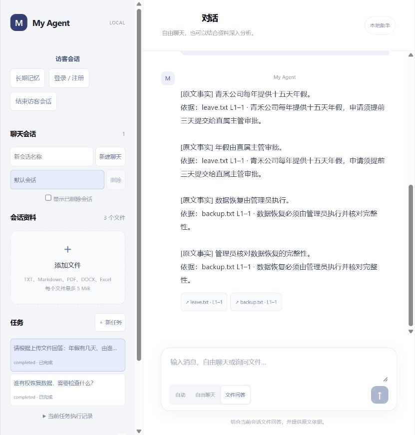
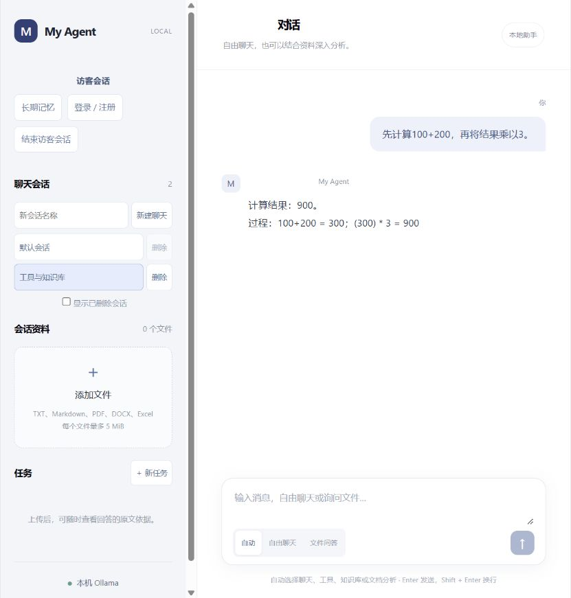
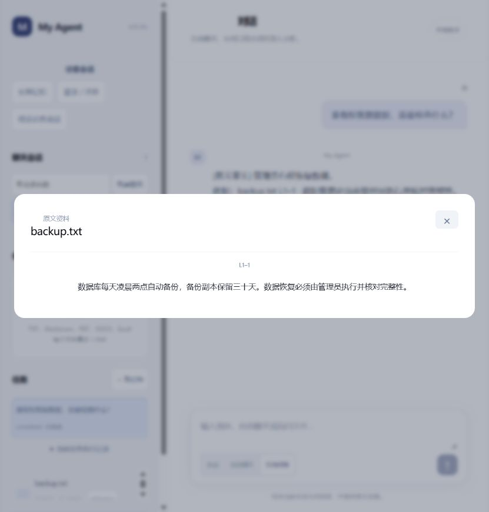
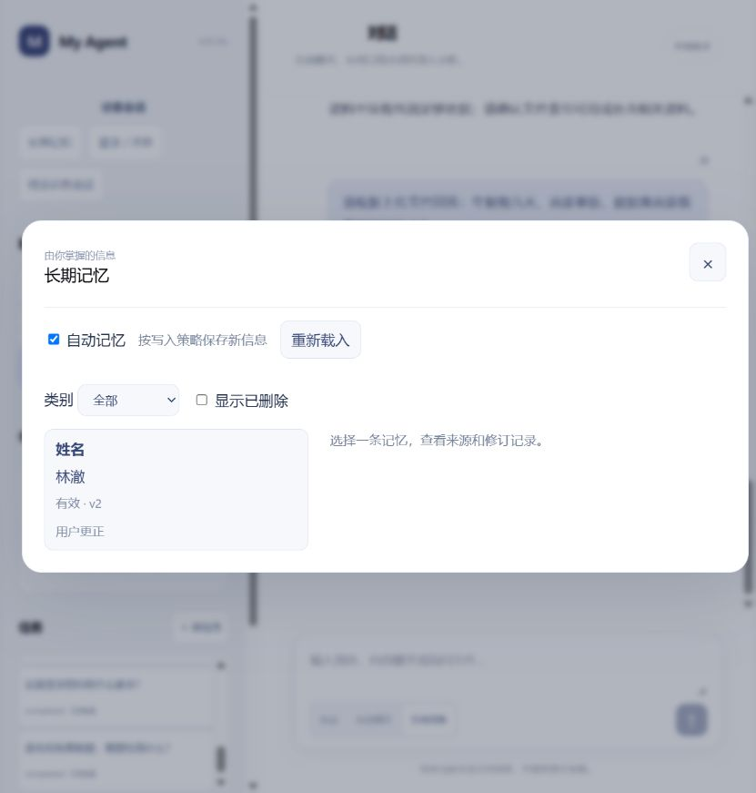

# 🤖 My-Agent · 本地 Agent 与带引用知识库

使用 **LangChain + LangGraph、FastAPI、React / Vite、SQLite、Ollama 和 Chroma** 的个人 Agent 项目。支持聊天、多步工具任务、文件问答、长期记忆和多会话。

🎯 适合本地学习和面试演示。本候选仅展示源码，不包含模型、第三方二进制、用户数据或原 Git 历史；不是生产公网部署承诺。

## ✨ 核心功能

|模块|实际能力|
|---|---|
|🔐 用户|访客、注册、登录、退出、密码及设备会话管理，服务端身份校验|
|💬 对话|多轮聊天、会话切换、历史持久化、软删除恢复|
|🧩 Planner|Pydantic 结构化计划、依赖校验、真实结果传递、有界执行|
|🧰 Tools|LangChain calculator、time、file_reader；自动规划只开放 calculator/time|
|📎 文档|TXT、Markdown、文字 PDF、DOCX、XLSX，解析和真实位置引用|
|🔎 RAG|本地 Embedding、Chroma、授权混合候选、0.65 语义门槛、严格词法分支和引用核验|
|📚 文档流程|摘要、缩写、版本核对、工期分析，保留完整文档处理路径|
|🧠 Memory|用户级长期记忆、来源与版本、纠正、删除保护、开关和管理界面|
|🔄 恢复|SQLite 任务、LangGraph checkpoint、有界历史摘要、请求防重放和协作式超时|

## 🏗️ 技术分工与架构

LangChain 提供 ChatModel、Prompt、标准 Tools、Document 和切分器；LangGraph 管理节点、状态、条件路由和 checkpoint。没有另建第二套 Agent。SQLite 是业务原文和状态的事实来源；Chroma 索引可以重建，不替代原文。



## 📂 目录

```text
src/agent/       模型、上下文、Planner、节点与文档任务
src/tools/       注册表与受控工具
src/retrieval/   加载、切分、Embedding、索引、RAG
src/memory/      长期记忆策略与存储
src/server/      API、认证、历史、迁移、协调与备份
frontend/src/   React 页面与组件
tests/          单元及独立验收脚本
docs/           架构、验收、许可证与 Windows 教程
```

## 🚀 Windows 快速启动

已使用环境：Python 3.11.4、Node.js 24.18.0、npm 11.16.0。Python 依赖以 requirements.txt 为准，前端使用锁文件。进入**解压后的项目根目录**，执行：

```powershell
py -3.11 -m venv .venv
.\.venv\Scripts\python.exe -m pip install -r requirements.txt
npm --prefix frontend ci
ollama list
```

本地需要已有 `qwen2.5:7b` 和 `embeddinggemma`。首次使用且缺少模型时，用户可以自行执行 `ollama pull qwen2.5:7b`、`ollama pull embeddinggemma`（需要联网和磁盘空间）。本轮验收没有下载模型。

启动 Ollama 桌面程序；只有未运行服务时才执行 `ollama serve`。然后分别打开两个 PowerShell，在项目根目录执行：

后端终端：

```powershell
$env:MY_AGENT_MODE='local'
$env:MY_AGENT_MODEL='qwen2.5:7b'
$env:MY_AGENT_OLLAMA_URL='http://127.0.0.1:11434'
$env:MY_AGENT_EMBEDDING_MODEL='embeddinggemma'
$env:MY_AGENT_EMBEDDING_URL='http://127.0.0.1:11434'
.\.venv\Scripts\python.exe -m uvicorn src.server.api:app --host 127.0.0.1 --port 8000 --workers 1
```

前端终端：

```powershell
npm --prefix frontend run dev -- --host 127.0.0.1 --port 5173 --strictPort
```

浏览器打开 **http://127.0.0.1:5173**；健康检查 **http://127.0.0.1:8000/health**。Local HTTP 是应用原有开发模式；Demo HTTPS 的 Secure Cookie 要求保持不变。不要在本地启动教程中混用 Demo 公网 Origin。

完整安装、模型准备、手工验收、关闭和故障排查见 [Windows 手动运行教程](docs/windows-local-guide.md)。

## 🎬 面试演示（约 8 分钟）

1. 进入访客或注册虚构账号，聊天后刷新，展示历史保存。
2. 输入“先计算100+200，再将结果乘以3”，展示真实结果 900；再询问当前时间。
3. 告知“我叫林舟”，再纠正为“我的名字改为林澈”，打开记忆管理核对版本。
4. 新建会话，验证对话历史隔离与用户长期记忆共享。
5. 上传两份虚构 TXT：一份写年假10天、部门经理审批；另一份写数据库恢复由管理员执行并核对完整性。
6. 等文件显示可检索，使用文件问答模式同时询问年假与恢复规则，点击两个引用核对原文。
7. 询问资料未说明的折现金额，展示证据不足；删除文件后再次提问。

file_reader 是显式授权的内部工具，当前不会因普通聊天而开放任意路径读取；源码节点验收通过，不宣称浏览器直接调用已通过。

## 🖼️ 真实运行截图

以下来自独立虚构数据的真实浏览器，未制作假界面。






## ✅ 验证范围

- 最近业务修复后的单元测试记录：**161/161**；真实 API 定向记录 **18/18**。
- 最近 RAG 浏览器专项：**8/8**，含多要点、跨文档、原 0.6372 案例、拒答和删除，不在本轮重复执行。
- 本轮：依赖检查、前端 lint/build、实际 file_reader→LangGraph、异常/超时/数据库保守处理定向检查通过。
- Windows 同端口两个 Worker 本轮有限验收通过；使用替身模型，4个同时请求返回1个200和3个409，不代表真实模型并发吞吐通过。
- Docker 有实现，但本机服务未启动，容器构建和运行未验证。OCR、SMTP真实发送、其他机器安装及公网生产未验证。

详细依据与剩余问题见 [最终验收](docs/final-acceptance-20261125.md) 和 [发布安全检查](docs/final-publication-safety.md)。

## ⚠️ 已知限制

- 注销后注册页面的“保留访客”选项可能残留，产生409；显式进入新访客并取消保留后可继续，本轮未改业务代码。
- Windows 偶见连接关闭 WinError10054 日志；已完成浏览器业务未受阻，原因尚未完全确认。
- 同步模型调用不能强制中止：等待实际返回后才终结超时，禁止继续后续步骤；总预算不是硬实时中断。
- Embedding、模型和磁盘性能影响耗时。0.65 是余弦门槛，不是答案正确概率；词法候选也须经过答案与引用校验。
- 摘要和工期分析仍需人工核对；扫描 PDF 需要额外 OCR 环境，XLSX 公式不重新计算。
- 默认嵌入式 Chroma 使用单 Worker。共享 Chroma Server 需另行配置；本轮双 Worker 测试没有覆盖真实向量并发。
- 公网完整限流、存储配额、运维和安全加固仍有缺口，不建议直接开放为生产服务。

## 📜 许可证

项目自有且有权授权的代码采用 [MIT](LICENSE)，Copyright © 2026 xyx-712。第三方依赖、Vite 素材与模型不被重新授权为 MIT。保留 [第三方声明](THIRD-PARTY-NOTICES.md) 和原始版权文件。

grpcio、NumPy、ONNX Runtime、orjson、Pillow、sqlite-vec、tokenizers、lightningcss-win32-x64-msvc **8项仍待人工签核**，不宣称全部兼容。EmbeddingGemma 另受 Gemma 条款约束。发布范围仅源码；未来打包二进制、容器或模型时需重新审查分发义务。

