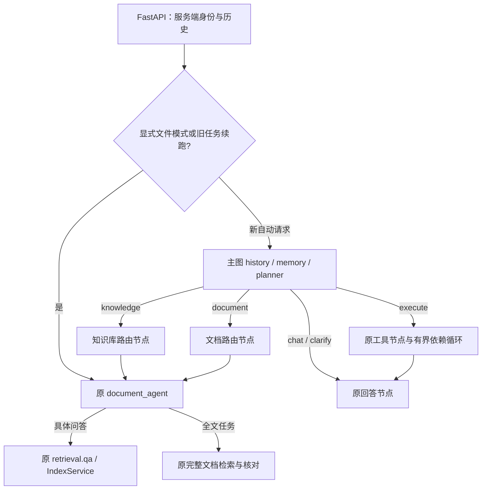

# 🧭 第四阶段第四小阶段：Planner、主图与前端集成

日期：2026-11-24。基线34/34；最终37/37（5.029秒）。未提交推送Git，未改变原始文档表、长期记忆结构、上传系统或相关性门槛。

## 文件清单

修改：src/agent/planner.py、tool_router.py、state.py、graph.py、document_agent.py；src/server/api.py；frontend/src/App.jsx；tests/rag_browser_evaluation.py；README.md、docs/local-evaluation.md。

新增：tests/test_rag_planner.py、tests/rag_planner_evaluation.py、本文。此前各阶段工作区修改保留。

## 分类与入口

TaskPlan保留原工具步骤、8步上限和依赖校验，增加两个无工具参数的动作：

| 动作 | 用途 |
| --- | --- |
| chat | 普通聊天、无需附件的通用知识和历史/记忆问答 |
| execute | calculator/time单步或多步依赖；工具白名单和数值结果引用不变 |
| knowledge | 当前授权附件的具体事实问答 |
| document | 全文摘要、缩写、版本冲突、批准变更或工期核对 |
| clarify | 缺少工具所需参数等明确追问 |

模型读取带角色近期消息和服务端提供的文件ID/名称列表，不读取全库原文来规划，也不能指定另一用户的范围。文件名作为不可信数据放在结构化请求正文。不是仅凭“文件”字样强制进入RAG，例如解释PDF格式仍可普通聊天。

对显式的全文摘要/缩写与附件指向、工期/版本冲突等请求增加保守校验：已有文件时，不允许模型回放历史计算或选择普通聊天；格式/意图错误按原最多两次校验尝试处理，不偷偷改工具参数。语义歧义仍由模型判断，无法保证任意措辞都分流正确。

## 主图与原文档子图



RAG启用时，FastAPI调用document_turn的defer_new选项，只提前处理显式文件模式和已识别的续跑；新的自动消息交给主图Planner。原文档子图保留，主图knowledge/document节点委托它执行，不新建Agent。自由聊天模式明确禁止路由到附件节点；已有任务不被普通聊天覆盖。关闭RAG后台时保留旧的自动分流兼容路径。

IndexService继续只提供证据；retrieval.qa继续复用同一模型、提示模板、门槛和引用验证，两个入口均调用这一条链。复杂任务仍使用完整文档核对，不能以Top-K代替。检索授权、READY/model/generation校验不变，普通Planner不提供任意路径或向量集合参数。

主图每轮清空旧引用、文档结果及执行记录，防止工具回答带上上一任务引用。API返回主图文档节点的citations/task/tool_calls；现有/task统计语义检索接受片段数，避免显示为0。任务与证据仍由原SQLite任务机制保存。

原文档子图compile(checkpointer=False)，明确不继承主图checkpoint；其恢复仍使用已有SQLite任务记录。原因是嵌套执行若自动继承checkpoint，会尝试序列化注入的模型对象（实测报Model无法msgpack序列化）。没有删除checkpoint或关闭主图持久化。

## 前端

复用上传、索引状态/重试、任务切换、引用按钮及原文面板。自动模式提示改为选择聊天、工具、知识库或文档分析；文件模式继续明确使用当前附件，自由聊天模式保留附件任务。多来源回答使用原多引用组件，检索失败/无依据沿用后端明确提示，没有重做上传或新增页面。原文查看为文件片段面板，尚无自动高亮。

## 实测与中途失败

- 单元37/37，新增知识/文档动作严格结构、模型分类与自由聊天覆盖、最后一轮全文请求禁止重放历史工具的测试。
- 新rag_planner_evaluation离线通过：真实API/主图/子图/Chroma，替身模型与Embedding；单/多文档、第二身份隔离、删除再问、引用重置、自由聊天、1+4、300→900、全文摘要。
- 新脚本--real最终通过同一API的自动知识问答→聊天→自由聊天覆盖→单工具→依赖计算→全文摘要→删除再问，实际使用embeddinggemma和Qwen2.5:7b。
- rag_closure_evaluation真实跨文档联合、同主题无答案、PDF第2页、DOCX段落/表格最终通过，27.834秒；本轮未改阈值，默认0.65仍存在保守拒答。
- rag_browser_evaluation --auto最终通过Edge生产构建：上传PDF/DOCX→READY→自动提问→引用→原文位置。明确文件模式仍复用同一路径；本轮重点浏览器验收自动模式。
- 回归通过：planner、abstract、auth、network、chat_routing、local、advanced、concurrency_backup、document_preparation、model_prompt、vector_index脚本。涵盖摘要缩写/续跑、版本工期、历史角色与当前消息只加入一次、账号隔离、删除/重建和备份恢复。前端lint/构建与git diff --check通过。

开发中保留的失败：嵌套子图继承checkpoint造成模型序列化错误，已修复；泛问被真实模型判为chat，文件指向前缀导致相似度0.572低于门槛，均未降低校验掩盖；真实模型把上轮300→900计划重放到“总结全部文件”，通过全文意图校验与有限重试后复跑通过。浏览器中途曾因未获得引用而超时，最终明确任务动作与无steps约束后通过。测试夹具增加“年假”分类分支以匹配扩展用例，生产模型不使用该替身规则。日志保留于忽略目录.demo-runtime/rag-stage4-*.txt，以最终退出码为准，不把中途断言通过当作全套通过。

## 复现

按README启动Ollama、单Worker后端与Vite；确认embeddinggemma、qwen2.5:7b已安装。上传虚构制度，等“可检索”，在自动模式问“根据上传文件，员工年假有几天，找谁申请？”。再问独立计算，最后“总结全部文件”，核对引用与任务保留。

```powershell
cd <LOCAL_PROJECT_PATH>
.\.venv\Scripts\python.exe -X utf8 -m unittest discover -s tests -v
.\.venv\Scripts\python.exe -X utf8 -m tests.rag_planner_evaluation
.\.venv\Scripts\python.exe -X utf8 -m tests.rag_planner_evaluation --real
.\.venv\Scripts\python.exe -X utf8 -m tests.rag_browser_evaluation --auto
npm --prefix frontend run lint
npm --prefix frontend run build
```

测试使用临时数据库/向量目录，真实脚本需Ollama服务，浏览器需Edge。嵌入式Chroma仍仅单Worker；本轮未新增向量多Worker、OCR或SMTP验收。模型路由、证据充分性和阈值仍需更多真实场景评估；未实现一份计划中混合“检索结果数值→计算器”的新步骤类型，不应把现有独立多工具依赖宣称为任意RAG工具混合计划。

本阶段完成后停止，等待第五小阶段确认。
