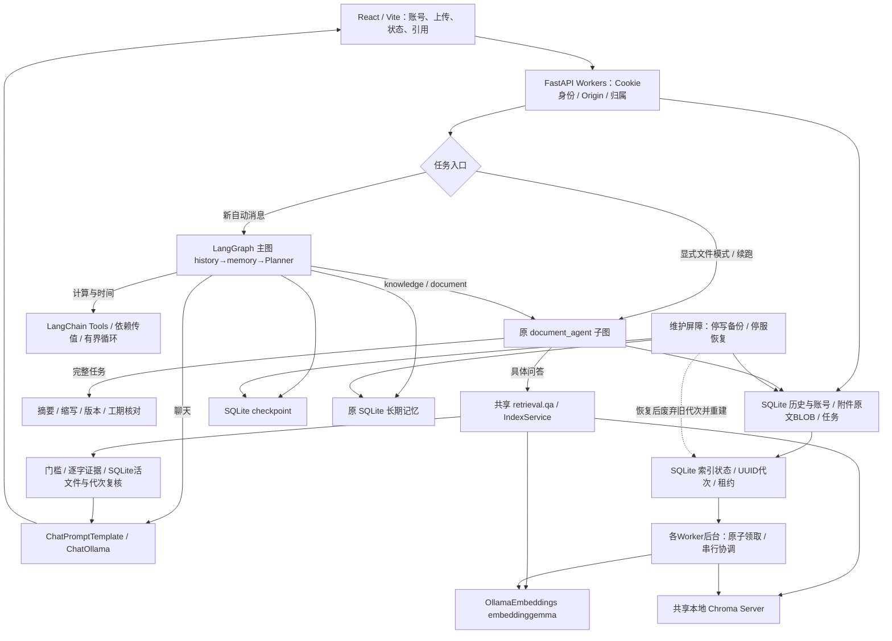

# 🧪 My-Agent 第四阶段最终验收

日期：2026-11-24。Windows、Python 3.11虚拟环境、Ollama、本机Qwen2.5:7b与embeddinggemma（768维），chromadb 1.5.9、langchain-chroma 1.2.0。所有测试用临时数据库、临时Chroma目录、虚构资料/账号与独立Edge配置，不读取个人文件，不提交或推送Git。

## 📦 第五小阶段改动

- 修改src/retrieval/store.py：共享HTTP连接适配、拒绝含凭据/查询/片段的异常服务URL。
- 新增src/retrieval/chroma_http.py：服务心跳10秒预检，官方HTTP客户端初始化后设置10秒请求上限；适配锁定版本的内部HTTP会话。
- 修改src/retrieval/embeddings.py：索引配置指纹包含Chroma服务/目录，切换存储自动使旧状态失效。
- 修改src/agent/tool_router.py：自由聊天不加载附件列表，避免“总结文件”被附件全文意图校验误拦截。原Long-term Memory结构不变。
- 修改src/config.py：使用一次lstat元数据快照检查数据库路径，容忍SQLite并发移除临时日志文件；仍拒绝非普通文件、符号链接和硬链接。新增tests/test_demo_path_race.py复现竞态与安全边界。
- 新增tests/chroma_server_evaluation.py、rag_fault_evaluation.py、rag_performance_evaluation.py、test_chroma_transport.py；修改tests/test_rag_planner.py补充自由聊天回归。
- 修改.env.example、README.md、docs/local-evaluation.md，新增本文。无新增依赖。前四小阶段和更早的工作区成果全部保留。

## 🖥️ 部署与启动

采用[Chroma官方客户端/服务端模式](https://github.com/chroma-core/docs/blob/main/docs/usage-guide.md)，并核对本机`chroma run --help`。一个独立Chroma进程管理持久化目录，多个FastAPI Worker通过HTTP连接它。浏览器只访问FastAPI，不访问Chroma。

首次停止旧后端，安装requirements.txt。Ollama桌面服务开机后可自动运行；没有后台服务时才另开终端运行`ollama serve`。确认安装qwen2.5:7b与embeddinggemma。

终端1，共享Chroma（保持打开，目录不得同时被嵌入式客户端使用）：

```powershell
cd <LOCAL_PROJECT_PATH>
.\.venv\Scripts\chroma.exe run --host 127.0.0.1 --port 8002 --path <LOCAL_PROJECT_PATH>
```

终端2，后端：

```powershell
cd <LOCAL_PROJECT_PATH>
$env:MY_AGENT_MODE='local'
$env:MY_AGENT_MODEL='qwen2.5:7b'
$env:MY_AGENT_OLLAMA_URL='http://127.0.0.1:11434'
$env:MY_AGENT_EMBEDDING_MODEL='embeddinggemma'
$env:MY_AGENT_EMBEDDING_URL='http://127.0.0.1:11434'
$env:MY_AGENT_RAG_ENABLED='1'
$env:MY_AGENT_CHROMA_URL='http://127.0.0.1:8002'
.\.venv\Scripts\python.exe -m uvicorn src.server.api:app --host 127.0.0.1 --port 8000 --workers 2
```

终端3，前端：

```powershell
cd <LOCAL_PROJECT_PATH>
npm install
npm run dev -- --host 127.0.0.1
```

打开终端所示地址（通常http://127.0.0.1:5173），注册/登录或进入访客。上传虚构TXT、PDF、DOCX，等待可检索，在自动模式明确问“根据上传文件，员工年假有几天，找谁申请？”，核对引用，再试独立计算与“总结全部文件”。

如果只用嵌入式Chroma，移除MY_AGENT_CHROMA_URL并保持`--workers 1`。各Worker必须使用相同数据库路径、模型、切分与Chroma设置。切换存储后会重新建索引，不直接复制/复用旧嵌入式目录。

## 🔐 并发与恢复边界

集合仍按身份/配置/模型digest哈希隔离，查询先验证所属文件范围，再按owner/document/generation过滤，最后重查SQLite活文件与READY代次。原文及来源位置从SQLite校验，不相信向量库的任意来源描述。

SQLite事务原子领取PENDING，INDEXING持有者令牌与120秒任务租约，批次写入及发布前验证租约、代次、原文哈希、模型与向量数量。原协调数据库的全局索引操作租约使**不同Worker的索引执行串行**；不是并行索引吞吐方案。完整成功才能READY，过期INDEXING重新排队，批次可能重做但ID幂等，不承诺物理恰好执行一次。

同一身份的并发API操作仍可能返回409；客户端应稍后重试，不能将16个请求的部分成功宣称为16个并发成功。读删冲突同样可能409；删除事务完成后必须404/不可检索，删除前已经完成的查询可以返回此前有效证据。回答生成后还复核归属与索引代次。

旧模型、切分或存储配置不能当作READY继续使用；索引暂不可用不改成无证据生成。Chroma停止时检索503，独立算式仍可计算。Ollama停止时普通模型回答无法正常生成，Planner返回有界错误，纯算式快路径仍可用。SQLite核心身份/历史库损坏时不能保证聊天服务，需停服检查/恢复；本轮只注入索引状态访问失败并验证503、不调用模型编造答案，没有伪造真实磁盘损坏。

## 💾 备份与恢复

现有命令建立共享维护屏障，要求没有进行中的操作，再用SQLite backup API备份app/memory/checkpoint三个数据库并校验完整性和摘要。账号、附件BLOB/原文、历史、任务/证据、记忆与checkpoint均在原数据库内。协调库是运行租约状态，不冒充业务快照。

Chroma不属于备份的一致快照。恢复必须停止**全部FastAPI Worker**，在线恢复被拒绝；强制结束进程会保留90秒运行租约，实测等待92秒后再恢复。恢复撤销登录令牌、清空派生索引状态；重新登录，后台从SQLite原文建立新代次。旧物理向量即使留存也不进入READY查询范围。

```powershell
# 环境变量与后端保持一致，使用尚不存在的新目录
.\.venv\Scripts\python.exe -m src.server.backup backup data\backups\stage4-20261124
# 停止所有后端Worker后才执行；先另行保留当前业务备份
.\.venv\Scripts\python.exe -m src.server.backup restore data\backups\stage4-20261124 --confirm-restore
```

Chroma可独立保留其目录作为运维材料，但分别复制两个位置不是跨存储在线一致备份。恢复后旧孤立向量可能占磁盘，需要停服维护；本轮不自动删除整个旧向量目录。

## ✅ 验收清单

| 能力 | 实际验收 |
| --- | --- |
| 普通聊天、历史与记忆 | 单元记忆持久化、model_prompt近期角色/当前消息一次、chat_routing；真实聊天性能及Planner真实脚本 |
| Calculator/Time/File Reader | 标准工具单元、Planner单步/多步/失败停止；File Reader为受限内部工具，没有开放模型任意磁盘读取 |
| 单/多文档RAG、无依据拒答 | rag_planner离线/真实、rag_closure真实跨文档与同主题缺答案；真实最终闭环34.445秒 |
| PDF/DOCX来源 | 真实PDF第2页、DOCX段落/表格，Edge自动模式点击引用查看原文通过 |
| 摘要、缩写、版本与工期 | abstract、local、advanced、network、document_preparation回归 |
| 上传/删除/认证/隔离 | auth、document_preparation、vector_index、双Worker共享服务测试 |
| 任务/进程/备份恢复 | vector_index三进程恢复、concurrency_backup证据复用及回滚、共享服务重启与SQLite恢复后新代次重建 |
| 故障 | Embedding拒绝连接/缺模型→FAILED→重试；Chroma不可用→503、算式仍可用；索引中途失败与重试；SQLite索引访问注入503；Ollama拒绝连接→明确规划错误 |
| 前端 | lint、生产构建通过；真实Edge上传→READY→自动问答→引用→原文通过 |
| 单元 | 最终43/43，最近复跑4.981秒；pip check、git diff --check通过 |

完整执行脚本还包括planner_evaluation、chat_routing_evaluation、auth_evaluation、account_management_evaluation、model_prompt_evaluation、local_evaluation、advanced_evaluation、network_evaluation、document_preparation_evaluation、abstract_evaluation、vector_index_evaluation、concurrency_backup_evaluation、rag_planner_evaluation与rag_fault_evaluation。

中途失败没有掩盖：共享HTTP自定义实现被上游实现白名单拒绝，回到官方客户端；并发互斥409曾被测试误要求全部200。Windows连接重置初步排除了系统代理，随后保留服务日志定位到Worker启动时SQLite临时日志文件消失导致安全检查失败，最终修复该竞态。测试自己的SQLite连接未关闭造成临时目录清理失败，改为明确关闭。另修复自由聊天误触发全文校验，并加回归。最终结果以完整退出码为准，忽略目录.demo-runtime保留分项日志，不提交临时数据。

## ⏱️ 性能记录

本机小型单文件、热模型、单次样本，不是负载或P95保证。模型计时由LangChain回调测量RPC往返，包含传输、排队及模型服务处理；**不是纯GPU推理时间**，本轮没有服务端纯推理/token速度数据。

| 项目 | 秒 |
| --- | ---: |
| 导入/图初始化 | 0.821 |
| TestClient应用启动生命周期 | 0.135 |
| 首次单文件索引 | 0.855 |
| 查询Embedding RPC | 0.111 |
| 已有向量的嵌入式Chroma查询 | 0.00175 |
| 授权检索总计（含Embedding/SQLite校验） | 0.131 |
| RAG完整回答 | 8.134 |
| 其中Qwen RPC | 7.968 |
| 其余（含Embedding、检索、校验等） | 0.166 |
| 普通聊天总计（含规划） | 10.474 |
| 其中模型RPC | 10.381 |
| 其余后端处理 | 0.094 |
| 单文件热重建 | 0.240 |

独立Uvicorn双Worker启动到health、共享HTTP检索、重建和并发状态计数见下方最终共享服务记录；共享场景包含排队/状态轮询，不能与0.00175秒纯嵌入式查询混为一谈。

### 最终共享服务记录（完整退出码0）

`tests.chroma_server_evaluation`最终使用真实Chroma Server、真实embeddinggemma和两个Uvicorn Worker（PID 29000、32248）；该并发脚本的对话模型使用替身，真实Qwen另由问答/性能/浏览器脚本验收。

| 项目 | 结果 |
| --- | --- |
| 启动到首个health | 3.718秒（不等于全部Worker就绪时间；随后验证两个PID） |
| 两身份文件上传至READY | 3.931秒 |
| 共享HTTP授权检索（含Embedding RPC） | 0.237秒 |
| 16个并发查询 | 2个200、14个409；通过者均有正确归属证据，无跨账号来源 |
| 替身模型普通聊天API | 0.104秒，不能当作真实推理性能 |
| 共享Server重新索引到READY | 1.694秒（含排队与轮询） |
| 读删竞争 | 删除200，竞争查询404，之后查询404 |
| Chroma停服 | 检索503；算式仍可用 |
| Chroma原目录重启 | READY原代次直接复用 |
| SQLite在线恢复 | API Worker仍登记时拒绝 |
| 强制停服后恢复 | 等待92秒真实租约过期，恢复成功；旧登录令牌撤销、索引状态清空，双Worker启动后从原文重建新代次并检索；计算可用 |

临时数据库句柄明确关闭后，测试业务断言及临时目录清理均成功。无需忽略清理异常来得到退出码0。脚本实测日志：`.demo-runtime/chroma-server-complete.txt`，服务日志：`.demo-runtime/chroma-server-process-last.log`。

## 🧩 完整架构



## 📌 限制与未验证

- 共享Chroma只验证同一台Windows、本地回环、两个API Worker及小规模请求，不代表多主机、长期压力或高可用。Chroma端口必须保持私有；真实服务鉴权、远程TLS与网络分区未验证，不应直接暴露公网。
- 强制每次请求Connection:close的并发短连接曾出现Windows连接重置；最终使用正常连接复用通过，未证明该短连接压力边界已经消除。不能将本轮称为无错误高并发压测。
- 全局索引协调当前串行；同身份409较多，尚无前端自动退避队列。不承诺任意数量Worker或物理恰好一次执行。
- HTTP预检和已建连接请求有10秒上限；锁定版上游客户端的构造期发现请求没有官方超时参数，预检后立刻失联的极窄竞态仍待更换上游支持方式验证。适配用内部会话字段，升级chromadb需复跑。
- 阈值0.65/Top-K4未降低。上一轮中文扩展10问正确来源保留5/10，可能保守；相关性与answerable均不等于逻辑正确性证明。
- 真正断电、磁盘损坏、业务SQLite全面不可用、跨机网络分区未实测；本轮故障替身/拒绝连接不能冒充这些验证。
- 原文查看仍为面板，无自动精确高亮；本机命令未找到Tesseract，SMTP_HOST配置为空，真实OCR和邮件发送仍待环境支持，只有替身/缺依赖路径验收。无新的云服务、公网入口或真实邮件。

复现测试命令：

```powershell
.\.venv\Scripts\python.exe -X utf8 -m unittest discover -s tests -v
.\.venv\Scripts\python.exe -X utf8 -m tests.chroma_server_evaluation
.\.venv\Scripts\python.exe -X utf8 -m tests.rag_fault_evaluation
.\.venv\Scripts\python.exe -X utf8 -m tests.rag_performance_evaluation
.\.venv\Scripts\python.exe -X utf8 -m tests.rag_closure_evaluation
.\.venv\Scripts\python.exe -X utf8 -m tests.rag_browser_evaluation --auto
```

共享服务验收会启动并关闭仅由测试创建的本地进程，强制退出后等待92秒租约再恢复，通常需两分钟以上；不操作用户的现有服务。第四阶段结束后停止，不自动开始第五阶段。
