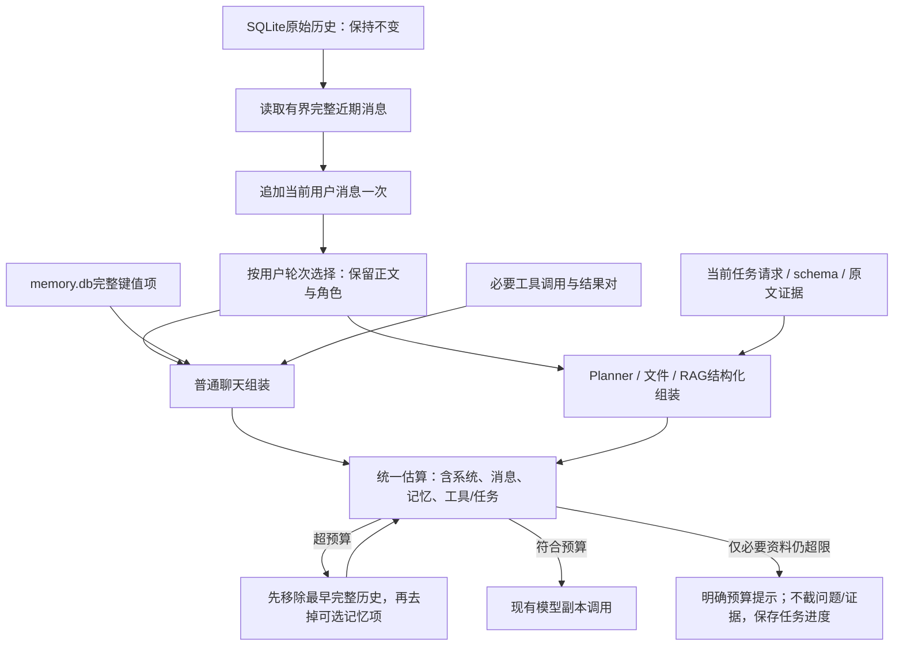

# 🧠 第五阶段第一小阶段：统一上下文预算

日期：2026-11-24。实施前单元基线43/43（4.983秒），本轮最终55/55。仅统一消息选取、提示组装与调用预算，没有新增摘要模型、独立Memory系统、数据库字段、前端或API请求参数，没有提交推送Git。

## 文件与职责

| 文件 | 本轮改动 |
| --- | --- |
| src/agent/context.py（新增） | 预算配置、可替换计数器、完整历史轮次选择、当前消息身份去重、聊天/结构化提示组装、实际模型调用参数副本 |
| src/server/api.py | 原最近10条/6000字符/每条尾部1500截断改为读取有界完整消息；当前问题在保存历史前只追加一次，调用共同选择器 |
| src/agent/history_node.py | 使用相同完整轮次选择器，不再独立切最后10条 |
| src/agent/planner.py | 用统一窗口替代独立messages[-10:]；原Pydantic规划、动作与工具依赖不变 |
| src/agent/tool_router.py | 独立报告预算不足，避免将其误报为工具参数/模型故障 |
| src/agent/graph.py | 回答用共同聊天组装器；当前记忆以完整键值项选入；必要工具消息保留成对且不重复注入；预算不足明确结束本轮 |
| src/agent/skills.py | 现有结构化模型调用统一计入规则、schema、重试反馈和请求/证据；原引用验证不变 |
| src/agent/document_agent.py | 文件路由历史使用共同窗口；摘要批次过大时逐个减少完整片段，不推进未处理偏移；预算错误保存进度并单独说明 |
| .env.example / README / docs/local-evaluation.md | 配置与验收说明 |
| tests/test_context.py（新增） | 12项上下文单元测试 |
| tests/context_evaluation.py（新增） | 临时库真实API长历史、刷新/checkpoint和文档批次边界验证 |
| 本文（新增） | 实际结果与边界 |

工作区原有大量未提交修改来自先前阶段，本轮全部保留，未把它们描述为本轮新增。model_provider、memory.db结构、原文存储、checkpoint表、任务表和前端生产源文件未改动。

## 预算与优先级

| 环境变量 | 默认 | 含义 |
| --- | ---: | --- |
| MY_AGENT_CONTEXT_TOKENS | 8192 | 调用窗口，本阶段允许512–8192 |
| MY_AGENT_CONTEXT_RESERVE | 4096 | 为输出预留，必须大于0且小于窗口 |
| MY_AGENT_CONTEXT_TURNS | 5 | 最多保留5个历史用户轮次，另保留当前轮；允许1–50 |
| MY_AGENT_CONTEXT_MEMORY_TOKENS | 512 | 长期记忆提示配额，不是数据库删除限制 |

默认输入估算上限4096，实际Ollama调用用模型副本设置num_ctx=8192，num_predict不超过预留4096；不修改缓存基础模型，不重复创建独立模型服务，保留原环境变量、超时和替身注入。结构化调用原默认8192/4096不变；普通聊天也有明确生成上限。更改配置后建议重启后端。

估算采用UTF-8字节数/3向上取整，加消息封装开销，并计入工具调用元数据。它对常见英文较保守，**不是Tokenizer保证**，罕见文字、特殊符号及模型模板可能偏离。cost/chat/structured/prepare_messages留有counter参数供后续Tokenizer接入，本轮没有下载Tokenizer或新增依赖。

流程：



- 当前问题、系统规则、必要任务输入与工具调用/结果对不能偷偷截断；普通历史不会被切成后半截，前提和否定词随整条消息保留或整轮舍弃。
- 只对同一消息对象或相同非空消息ID的当前消息消除重复，不按正文去重。“同一句问题问了两次”仍是两个合法轮次。
- 记忆按完整键值项进入提示；包括换行的长事实不会只保留半条。超配额条目本轮可不注入，原memory.db记录不变。
- Planner与文档问答使用相同预算机制，仍各自保留系统指令/schema/证据格式。结构化请求仅裁历史列表，不裁request或sources；引文、页码及来源映射不变。
- 文件摘要若整批超限，按4→3→2→1等方式减少完整来源；只在答案通过原校验后推进实际处理数。单片段和必要规则仍放不下则等待用户缩小任务，不能伪造完成。
- 不把已保存的其他附件任务自动塞入普通聊天。文件的当前任务和证据作为结构化请求必要数据计算；组装器也支持显式task_context输入，但本轮不新增跨任务记忆注入。

## 测试结果

新增12项单元：单轮/角色顺序、当前身份去重、合法重复问题、长历史完整轮次、超长当前消息安全拒绝、工具调用/结果成对、记忆与任务共同预算、换行记忆不可拆分、证据不可截断、结构化历史裁剪不修改输入、自定义counter/模型副本、非法配置。

`context_evaluation`在临时库写入20轮虚构长历史，再加入含“不能删除任何文件”的完整长前提：实际API提示保留完整前提和当前问题一次，估算不超限；SQLite的44条历史仍在，刷新后续聊与checkpoint运行结果正确。另注入批次预算错误，验证组装尝试4/3/2/1，qa_offset只前进1，4份原始来源均保留。

Checkpoint兼容说明：原回答节点结束时将State.messages替换为助手回复。本轮未改变该行为，完整聊天仍从SQLite重建；不能要求最终checkpoint中的messages等于完整聊天库。测试同时核对checkpoint的运行结果与刷新后的源历史上下文。

| 验收 | 实测 |
| --- | --- |
| 全部单元 | 55/55；原43项继续通过 |
| 新API上下文用例 | 长历史、完整否定前提、当前一次、原始历史保留、刷新及批次偏移通过 |
| 原提示/聊天/工具 | model_prompt、chat_routing、planner、rag_planner脚本通过 |
| 文件/恢复 | document_preparation、abstract（含新进程续跑）、local、network、advanced、concurrency_backup通过 |
| 身份/索引 | auth、account_management、vector_index通过，后者含失败重试、删除、模型失效与三进程恢复 |
| 真实Ollama聊天 | 蓝杉代号两轮回忆通过，7.470秒 |
| 真实RAG | 跨文档、同主题无答案、PDF页码、DOCX段落/表格与引用通过，32.980秒 |
| 真实自动Planner | API自动RAG→聊天→工具依赖→完整摘要→删除再问通过 |
| Edge自动模式 | 上传→READY→提问→引用→原文面板通过 |
| 共享Chroma双Worker | 本轮业务日志含两个PID，16并发为2个200/14个409；服务重启、在线恢复拒绝、停服后原文重建通过，不能将409算作并行成功 |
| 前端lint / 构建 / git diff --check | 通过；未修改前端源文件 |

本轮中途的新增测试曾有一处缩进错误，已修正；API用例曾错误假设最终checkpoint保留完整用户历史，按既有节点实际职责修正断言，没有为该断言改动checkpoint架构。

## 启动和复现

不需要数据库迁移或安装新依赖。停止旧后端，按README原启动方法启动Ollama、后端和前端。可选在后端终端设置：

```powershell
$env:MY_AGENT_CONTEXT_TOKENS='8192'
$env:MY_AGENT_CONTEXT_RESERVE='4096'
$env:MY_AGENT_CONTEXT_TURNS='5'
$env:MY_AGENT_CONTEXT_MEMORY_TOKENS='512'
```

验证命令：

```powershell
cd <LOCAL_PROJECT_PATH>
.\.venv\Scripts\python.exe -X utf8 -m unittest discover -s tests -v
.\.venv\Scripts\python.exe -X utf8 -m tests.context_evaluation
.\.venv\Scripts\python.exe -X utf8 -m tests.model_prompt_evaluation --ollama
.\.venv\Scripts\python.exe -X utf8 -m tests.rag_closure_evaluation
```

## 限制与下一阶段

输入被限制的是估算预算，不保证与任意模型Tokenizer精确一致。本阶段无历史摘要，超窗口旧轮次会被舍弃；极长的最近历史轮次也可能整轮舍弃，不能承诺无限记住所有前提。必要资料单独超限时明确暂停，不擅自降低证据标准。较小文档批次可能更早触及原有6步上限，需要发送“继续任务”。

聊天历史与checkpoint磁盘占用仍会增长：本轮只限制模型输入，不自动清理数据库。旧JSON/旧Memory模块没有删除。没有升级长期记忆来源、置信度、冲突或删除机制，也没有引入独立会话ID。

下一小阶段可在确认后处理长期记忆元数据与受控更新策略；本轮不启动该工作。
