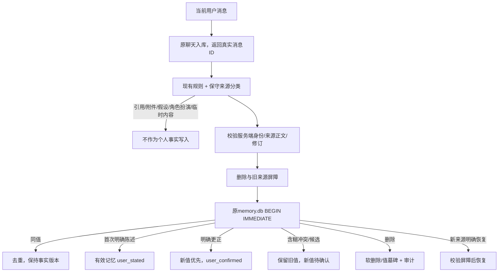

# 🧠 第五阶段第二小阶段：长期记忆元数据与写入策略

日期：2026-11-24。基线55/55；本轮单元72/72。复用原MemoryStore、memory.db、用户身份、聊天主键、主图和备份机制，没有第二套数据库、个人记忆向量库、LLM提取Agent、记忆前端或新的API请求字段。未提交推送Git。

## 数据库迁移与旧数据

`src/server/migrations.py:migrate_memories`在**原memory.db**中使用`BEGIN IMMEDIATE`事务执行增量ALTER，保留原memories表、记录ID、user_id/key/value与唯一约束，不重建、不清空。memory_schema_migrations记录本库版本1，重复执行安全。两进程同时初始化由SQLite事务协调。

| 新字段 | 用途 / 旧数据初始值 |
| --- | --- |
| source_message_id | 原chat_messages主键的逻辑关联；旧记录NULL |
| created_at | 记录创建UTC时间；旧记录NULL，不能伪造历史创建时间 |
| updated_at | 新值/状态变更UTC时间；旧记录NULL，首次新变更后才填写 |
| status | active、pending_confirmation、deleted；旧记录active |
| revision | 值或状态修订号；旧记录1，重复同值不抬升 |
| confirmation_state | unknown、user_stated、user_confirmed、pending；旧记录unknown |
| source_type | legacy、internal、user_statement、user_correction、user_restore、model_candidate；旧记录legacy |
| last_message_id | 已处理用户来源的顺序屏障，防旧操作覆盖；旧记录NULL |

旧记录仍可读取使用，但不会因迁移被标为用户确认。对旧行更新时保留原创建时间未知这一事实。重复陈述可推进last_message_id，而不重复保存或提升事实revision。

同一文件新增三个辅助表：

- **memory_events**：变更/候选/删除/恢复的审计，含身份、键、修订、来源、操作序号、时间与来源类型；消息/键/操作序号唯一，支持重放去重。
- **memory_candidates**：未确认新值；相同身份/键/值去重，状态pending/resolved/rejected。已解决冲突再次出现时可由新来源重新打开。
- **memory_tombstones**：键或值哈希的删除屏障、删除消息ID/版本/时间、显式恢复消息ID。

没有给原聊天表增加字段。`save_history`仅在原INSERT后返回已有lastrowid；API将它作为服务端运行状态传给记忆节点，客户端不能提供或覆盖该字段。写入前按user_id、消息ID、role=user和原始正文进行校验。跨库不使用虚假的外键保证，而使用服务端归属检查；原聊天仍是事实来源。

## 写入、更新与冲突



- 保留旧extract_memory函数兼容已有调用，主线节点使用extract_operations包装器。名字、爱好、职业继续由规则提取，不增加模型Agent。
- 引号、第三方转述、文档/附件、假设、角色扮演、临时要求等保守拒绝写入。未标注的转载无法可靠识别，不宣称具备通用语义判别。
- 同值去重；爱好等集合字段在事务内读取、合并、去重，消除旧的先读后写覆盖竞态。
- 不同姓名/职业的普通新陈述进入候选，旧有效值不覆盖；聊天路径明确追问。可发送“更正，我的名字是王五”“确认，我的职业是医生”“我的工作改为产品经理”。
- 含糊的“我是……”职业信息、相互矛盾的多姓名或不确定表达进入候选，不直接成为有效事实。明确姓名边界后才保存，减少把后续正文拼进名字的风险。
- 新模型候选只提供受控内部入口并做离线验证，没有接入真实LLM提取；候选不会提升为有效用户事实，也不能压过用户明确纠正。候选若没有旧有效值，memories只有空值控制行，供revision管理，不进入get/search或模型提示。
- 同一消息的多项操作在一个事务中执行，任何参数错误全部回滚。多值聚合行的source_message_id表示最近一次有效值写入来源，完整来源链由events对应原聊天追溯，不能声称一条消息证明整个聚合列表。

`get/search`继续返回原有key/value格式，只提供未删除且非空的有效值；pending_confirmation有旧值时仍使用旧值，**不提供候选新值**。主图继续从实时数据库读取，不信任checkpoint中的旧memory。待确认提示走现有上下文资料入口，未修改context.py整体架构。

## 删除防复活

- 删除字段保留控制行并标deleted；get/search不返回它。删除爱好中的单值，保留其余有效值并建立该值哈希屏障。用户明确“忘记我的名字”“我不喜欢苹果了”等规则受支持。
- 较旧来源ID不能覆盖较新用户操作；已处理的消息/操作重放不重复写。旧checkpoint直接调用无来源save，也不能绕过墓碑。
- 普通再次陈述被删除的值不会自动恢复，返回明确提示；需要新的有效用户来源及“重新记住…”意图。来源未知的删除还要求匹配当前expected_revision，单凭晚到的提取不能复活。
- 显式恢复记录restored_message_id；后续更新可继续，早于删除/恢复的旧来源仍被阻挡。墓碑和审计不会因恢复被抹掉。
- clear_user对当前已知键和候选进行软删除，不清空memories表；它不是对未来未知键的全局永久封禁。同一消息先删除再普通保存同一值，删除屏障优先；恢复应在后续明确消息中进行。

这是**长期记忆的逻辑删除**，不是物理擦除：原聊天、软删除行、审计/旧备份可能保留相关信息，近期历史也可能仍包含用户原话。本轮不清理历史或中止已经发送的模型请求。恢复包含墓碑的备份会继续保护删除；恢复到删除前的旧备份会回到当时状态，不能宣称跨旧备份保留所有后续删除。

## 并发、备份和迁移恢复

MemoryStore写入和初始化加入现有维护屏障，不能在备份中途独立写入。SQLite BEGIN IMMEDIATE、唯一约束、source顺序和可选expected_revision处理并发。迁移前检查未完成restore标记，避免在不完整恢复库上继续写。

备份模块无需增加另一套复制逻辑：原SQLite backup API覆盖整个memory.db，所以新增元数据、候选、事件、墓碑一起进入原三库一致性边界。源消息仍在同一备份的app.db。测试已实际恢复并核对上述数据和原来源；迁移中途拒绝ALTER的故障也能回滚并重试。

部署时必须先停掉全部旧Worker，保留完整备份，再统一启动新版本。**不支持新旧版本写进程混跑**；旧代码直接SQL删除/覆盖不会遵守新策略。没有自动合并agent_memory.db、memory.json等未接入主线的旧旁路数据。

## 文件清单

新增：src/memory/policy.py、tests/test_memory_policy.py、tests/memory_metadata_evaluation.py、tests/memory_workers_evaluation.py、本文。

修改：src/memory/store.py（保留MemoryStore及原公开接口/拆分助手，CRUD接入事务策略）、extractor.py；src/agent/memory_node.py、state.py、graph.py；src/server/history.py、api.py、migrations.py；README.md、docs/local-evaluation.md。

backup.py已检查并复用，没有为新增表改写备份格式。Planner、RAG、Tools、长期记忆数据库路径、context.py和前端未改；工作区其他未提交文件属于此前阶段。

## 实测结果

| 验收 | 结果 |
| --- | --- |
| 单元基线 | 55/55，5.228秒 |
| 本轮全部单元 | 72/72；新增17项，旧55项继续通过 |
| 迁移 | 保留旧ID/值，legacy/unknown/NULL，重复执行、故障回滚重试、两进程初始化通过 |
| 来源/策略 | 真实API消息ID、归属/正文/角色检查、陈述/纠正/候选、引用假设过滤、重复与冲突、单批原子回滚通过 |
| 删除 | 整键/单值、未完成旧写、无来源save、旧checkpoint、显式恢复、来源未知删除的版本门槛通过 |
| 双独立进程 | 各写5个集合值，最终10项，无覆盖；同时初始化通过 |
| 两个真实API Worker | PID3288和19076；初始4次有效写入确由两个PID处理，来源4/4，丢失更新0；共7个200、2个409后有界重试；跨浏览器删除与恢复通过 |
| 备份恢复 | 来源、revision、候选与墓碑恢复一致；恢复后无来源旧save仍被阻挡；写入期间备份被维护屏障拒绝 |
| 原功能回归 | auth、concurrency_backup、context、model_prompt、chat_routing、rag_planner、abstract、network、local、advanced、planner、document_preparation、account_management、rag_fault通过 |
| 真实模型 | 原两轮代号回忆通过7.235秒；真实跨文件RAG、无依据拒答、PDF/DOCX引用回归通过30.892秒 |
| 前端lint/构建、pip check、git diff --check | 通过；没有开发记忆前端 |

真实双Worker测试使用替身对话模型，Cookie Secure属性在Demo代码中未放宽，测试只在回环HTTP手工转发测试Cookie。规则/状态核心不依赖模型，本轮没有声称真实LLM已经可靠提取长期记忆。测试只用临时库和虚构账号，不用个人库做迁移验收。

## 启动与体验

无新增依赖。先停止所有旧后端，在相同配置环境中执行原备份命令（使用新目录），再按README启动。首次加载MemoryStore会事务升级memory.db；失败不清空旧表，修复环境后可重试。建议升级前保留旧代码版本和完整三库备份；回退需停服恢复匹配的备份，不能直接让旧写代码运行在新策略库上。

```powershell
cd <LOCAL_PROJECT_PATH>
.\.venv\Scripts\python.exe -m src.server.backup backup data\backups\before-memory-metadata
# 然后按原README启动后端和前端
```

同一账号在聊天模式依次发送：

1. 我叫李四
2. 我的名字是王五 → 冲突待确认，旧值仍为李四
3. 更正，我的名字是王五 → 更新并关联本轮消息
4. 忘记我的名字 → 不再作为有效长期记忆读取
5. 我叫王五 → 不自动恢复
6. 重新记住我的名字是王五 → 新来源明确恢复

规则只覆盖受支持表达；模型仍能从原聊天看到历史原话，不能把这一演示误解为删除整段聊天或让模型物理遗忘。

```powershell
.\.venv\Scripts\python.exe -X utf8 -m unittest discover -s tests -v
.\.venv\Scripts\python.exe -X utf8 -m tests.memory_metadata_evaluation
.\.venv\Scripts\python.exe -X utf8 -m tests.memory_workers_evaluation
.\.venv\Scripts\python.exe -X utf8 -m tests.concurrency_backup_evaluation
```

## 限制和下一步

保守规则会漏记带引号的真实自述、不常见姓名/复杂纠正、含文档词汇的偏好；不应将其描述为自然语言理解保证。未标注的一人称转载仍可能被视作自述。没有自动过期/保留期、物理擦除、跨备份删除账本或独立对话隔离。

旧记录来源未知不会自动补全；来源逻辑关联要求当前主线三库共同备份恢复。审计和候选会增长，尚无管理前端或保留期清理。显式文件入口仍沿用原行为，不把附件事实自动提取成个人记忆；未将两条入口重新编排。

聊天消息提交与memory.db写入不是跨数据库原子事务；记忆写入失败时可能留下尚未提取的用户消息，记忆事务本身会回滚。当前有来源/操作去重和旧写保护，但没有自动扫描所有遗漏消息的outbox补偿机制，不宣称跨库恰好一次处理。

本轮未复跑完整共享Chroma停服恢复压力与Edge界面流程；没有真实OCR/SMTP、跨机器并发或长时间负载验收。旧旁路记忆模块不在主线调用链，未删除或自动导入。第三小阶段可经确认后增加受控查看、确认、修改、删除界面及接口，本轮到此停止。
