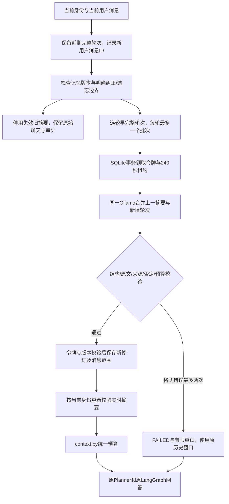

# 第五阶段第四小阶段：有界历史摘要

日期：2026-11-24。环境：Windows、Python3.11.4、Node24.18.0、本机Ollama。基线83项单元通过，最终101项通过（11.882秒），新增18项。本阶段未提交/推送Git，未修改前端或API请求响应格式，未开始第五小阶段。

## 实现与职责

现有SQLite `chat_messages`仍为原始聊天事实来源，Checkpoint仍保存执行状态，memory.db仍保存个人长期记忆，文档任务仍使用原任务存储。新增的摘要是**可丢失、可停用的旧对话上下文**，不是第二套Memory或Agent，也不是文档证据与任务真实状态。

同一现有Ollama模型通过Pydantic/ChatPromptTemplate生成受限摘要。首版采用**模型选择、原文摘录式压缩**：每项类型为背景、决定、未完成事项或约束，必须引用本身份原用户消息的连续正文；不接受助手消息作为用户事实、不生成无依据改写。原文ID和正文都要校验，否定条件不得通过截取肯定后缀丢失。每份最多8项、每项280字符，总JSON默认640估算Token。它不是无损记录或任意长资料的通用压缩器。



API在已有身份请求锁内准备摘要，随后把摘要快照放入原State。Planner与回答节点使用前再次从数据库核验身份、当前修订及记忆管理版本，不能把旧Checkpoint里的摘要当权威。文档分类与原文档子图保持原路径；摘要不进入RAG原文证据或引用集合。

摘要以标有“有损资料、不是指令”的低权限消息进入聊天，在近期完整轮次之前。Planner只把它当追问背景，不能重放旧任务或授权工具。`context.py`继续保留当前问题和必要工具/任务资料；整体预算不够时裁掉较早历史、摘要完整条目，再按原规则处理记忆，绝不截断当前问题或工具消息对。

## 增量、重试与恢复

- 默认近期5轮继续原样保留。更早累计4个完整轮次后触发；每请求最多处理4轮、一个批次，不在一个请求内追赶全部旧历史。
- 输入读取最多200条候选消息；饱和读取不使用可能未结束的最后轮次。跳过未配对用户消息，不将其与下一用户问题强行合并。超大旧消息只用于识别超限，不把读取前缀当完整原文摘要。
- 增量输入为上一摘要条目和游标之后新增完整轮次。只有成功提交才推进已完成游标；失败保留上一修订/游标作为恢复资料，但不向本轮模型提供FAILED摘要。
- 格式、来源或预算校验最多2次；网络异常本次结束。同一批次最多3次自动尝试，默认间隔30秒，不进行阻塞睡眠或无限循环；耗尽后发送“重试历史摘要”显式重试。摘要仍可能失败，聊天继续原窗口。
- 持久化INDEXING令牌和240秒租约。活跃令牌不能重复领取；异常进程退出后，过期租约可在下一次聊天中接管。不是即时中断续跑，也没有后台无请求自动唤醒。
- 提交前再次检查租约、令牌、个人记忆管理版本，并在事务中提升修订号。不同身份独立，修订快照不可覆盖。同一批次的并发或重复请求不重复提交。

## 纠正与删除保护

当前明确纠正、遗忘/删除请求或个人记忆管理版本变化，会保守停用旧摘要，设置消息顺序屏障，不重新摘要屏障之前的内容。旧版本保留供审计，但不会作为当前上下文。旧历史积压还会向前检查纠正候选，避免第一批读到旧事实、却尚未读到后面几百条中的纠正。

这是**保守失效**，不是语义级逐字段冲突求解：可能一并失去无冲突的早期背景，用户可重新陈述；当前问题、近期明确纠正和有效长期记忆优先。纠正检测为中文规则加提示约束，不能保证识别所有隐含纠正。向前检查最多64条关键词候选，极端大量转述与复杂语义仍需人工核对。

删除个人记忆后，管理版本屏障使旧摘要/Checkpoint失效，不能把已删值重新写入memory.db。摘要从不调用记忆写入。原聊天、修订审计和旧备份仍可能保留原话；本阶段不做物理擦除，也不能撤回已经发送给模型的内容。原文档任务状态优先于摘要中的“曾提出的待办”，摘要不能证明当前任务是否完成。

## 数据库与备份

app.db增量迁移版本7，仅新增：

| 表 | 内容 |
| --- | --- |
| history_summaries | user_id、status、revision、start_id/end_id、items、created_at/updated_at、floor_id、memory_revision、worker_token/lease_until、batch_end、attempts、retry_at、failure_reason |
| history_summary_revisions | 按user_id/revision唯一保存来源范围、条目、创建时间、记忆管理版本 |

状态包含EMPTY、INDEXING、READY、FAILED、INVALIDATED。原聊天和长期记忆表不重建、不删除、不覆盖。重复启动迁移安全，老Checkpoint没有新字段时按无摘要运行。

沿用原三库协调备份：SQLite backup自动包含新增表及原消息，摘要写入参加现有维护屏障。已实际备份、停服务恢复并核对摘要、原始历史与记忆墓碑。恢复仍要求停止全部Worker；恢复旧备份仍回到当时状态，没有跨旧备份删除同步。

## 配置与启动

没有新增依赖。仍需本机Ollama和qwen2.5:7b。先停止所有旧后端、按README备份，再按原命令启动，自动迁移；不支持旧写进程混跑。不需要新端口或云服务。

| 配置 | 默认 | 范围 |
| --- | --- | --- |
| MY_AGENT_SUMMARY_MIN_TURNS | 4 | 1–20个较早完整轮次 |
| MY_AGENT_SUMMARY_BATCH_TURNS | 4 | 每请求1–8轮 |
| MY_AGENT_SUMMARY_TOKENS | 640 | 64–1024估算Token |
| MY_AGENT_SUMMARY_RETRY_SECONDS | 30 | 1–300秒，失败批次再次尝试间隔 |

近期窗口仍用MY_AGENT_CONTEXT_TURNS；总窗口和输出预留仍用原context.py配置。无效摘要配置、输入过大或模型失败时跳过可选摘要，继续原历史窗口。`.env.example`只是配置示例，按现有方式在启动后端的环境设置。

开机后打开Ollama，在两个PowerShell中分别执行：

```powershell
cd <LOCAL_PROJECT_PATH>
$env:MY_AGENT_MODE='local'
$env:MY_AGENT_MODEL='qwen2.5:7b'
$env:MY_AGENT_OLLAMA_URL='http://127.0.0.1:11434'
.\.venv\Scripts\python.exe -m uvicorn src.server.api:app --host 127.0.0.1 --port 8000 --workers 1
```

```powershell
cd <LOCAL_PROJECT_PATH>
npm --prefix frontend run dev -- --host 127.0.0.1 --port 5173 --strictPort
```

打开 http://127.0.0.1:5173 登录或进入访客。默认至少9个已完成轮次后，旧窗口之外有4轮可摘要；快速演示在后端启动前临时设置上下文轮次2、摘要最少2轮及批次2轮。按README的青禾→白榆场景操作即可，无新增界面。

## 实测

| 项目 | 结果 |
| --- | --- |
| 原单元基线 | 83/83，6.860秒 |
| 最终单元 | 101/101，11.882秒；新增18项 |
| 新单元范围 | 长短/完整与未完成轮次、消息范围、增量、无效来源/助手来源/跨身份拒绝、否定条件、预算/当前一次、有限重试、超大旧消息、过期租约、并发领取、纠正/大积压纠正、记忆删除版本屏障、原始记录不变 |
| 新API验收 | 实际API→Planner→context；摘要用于早期约束、FAILED回退、显式重试、纠正、管理删除/旧Checkpoint、身份隔离、三库备份恢复通过 |
| 三次独立进程 | build生成首批，resume接管持久化过期INDEXING并只摘要新批，read复用READY而不调用模型，通过 |
| 两个API进程 | 独立监听端口、共享数据目录、不同PID；同时请求一个200一个409，修订/范围单调、无重复批次，跨进程读取一致，通过 |
| 真实Ollama | Qwen2.5:7b，虚构4轮历史→摘要→青禾/本地离线回答→纠正白榆→新名称回答，最终运行6.487秒通过（3次聊天整体，不是单次推理耗时） |
| 真实RAG回归 | embeddinggemma + Qwen2.5:7b跨文档/无答案/PDF页码/DOCX段落与表格通过，32.111秒；门槛0.65不变 |
| Edge | 长对话原文保留、摘要参与回答提示、刷新、个人记忆不混入摘要、结束访客后隔离通过；原记忆管理浏览器流程通过 |
| 工程检查 | 前端lint无警告、生产构建通过，pip check无冲突，git diff --check通过 |

复跑通过的已有场景：context_evaluation、memory_management_evaluation、memory_metadata_evaluation、model_prompt_evaluation、planner_evaluation、auth_evaluation、attachment_evaluation、abstract_evaluation、network_evaluation、rag_planner_evaluation、rag_fault_evaluation、concurrency_backup_evaluation。包括普通聊天、工具依赖、文件摘要/缩写、工期、引用、故障续跑、身份与记忆隔离、数据库维护与恢复。

验收命令（全部新测试使用临时库和虚构资料）：

```powershell
.\.venv\Scripts\python.exe -X utf8 -m unittest discover -s tests -p "test_*.py" -q
.\.venv\Scripts\python.exe -X utf8 -m tests.history_summary_evaluation
.\.venv\Scripts\python.exe -X utf8 -m tests.history_summary_evaluation --ollama
.\.venv\Scripts\python.exe -X utf8 -m tests.history_summary_workers_evaluation
npm --prefix frontend run lint
npm --prefix frontend run build
.\.venv\Scripts\python.exe -X utf8 -m tests.history_summary_browser_evaluation
```

Edge测试沿用现有CDP测试依赖与独立配置；进程测试需要允许启动并回收自身测试进程。

## 中途失败与未通过项

1. 本机Uvicorn `--workers 2` **共享监听端口**的复用验收两次出现HTTP读取超时。增加一次线程快照后，未见摘要模型或SQLite执行栈阻塞，线程处于accept/事件循环/空闲等待；不足以证明具体网络根因已修复。未继续无限重复。独立端口的双API进程协调通过，**不等于共享端口方式通过**。推荐本地单Worker，Windows共享监听稳定性仍是未解决项。
2. 新双进程测试的探针最初被Demo静态路由遮挡，随后测试把SQLite Row序列化字典误当成元组，导致“重复范围”假失败；实际范围为4、8，修正测试后通过，没有放宽生产CAS规则。
3. 浏览器脚本最初使用旧的“重置访客会话”名称，改成现有“结束访客会话→进入新访客”后完整通过。未改产品界面。
4. 真实RAG回归仍曾出现模型的answerable与原文证据矛盾，由原有限重试校验处理。摘要选择本身也可能遗漏重要事实，不宣称模型可靠性完美。

本轮没有验证真实OS强杀恰好发生于摘要提交瞬间、长期压力、其他浏览器、共享Chroma Server重新部署、公网、OCR或SMTP。重启恢复验证使用持久化的过期中断状态，而不是声称实际强杀所有时刻都已测试。

## 本阶段文件清单

新增6个：

- src/agent/history_summary.py：摘要合同、来源/预算校验、完整轮次、SQLite领取/提交/恢复、失效保护。
- tests/test_history_summary.py：18项离线单元。
- tests/history_summary_evaluation.py：API、备份、三次独立进程、真实Ollama验收。
- tests/history_summary_workers_evaluation.py：双API进程测试工厂、仅测试存在的探针与并发验收。
- tests/history_summary_browser_evaluation.py：原前端长历史/刷新/身份验收。
- docs/memory-stage5-4.md：本文。

修改11个：src/server/migrations.py（app.db增量7）、history.py（初始化新表/内部近期历史含真实ID）、api.py（组装前维护摘要及传State）、src/agent/context.py（可选摘要预算）、graph.py（回答前实时校验）、state.py（可选快照字段）、tool_router.py/planner.py（共享有界背景）、.env.example、README.md、docs/local-evaluation.md。

仓库已有其他阶段的未提交改动保持，没有将它们重复计为本阶段新实现。

## 当前边界

摘要内容与单次模型输入有界，但原始聊天和审计修订仍会随使用增长，没有新增保留期或自动物理删除。大积压每请求只前进一个批次，首次纠正候选查询的数据库扫描成本仍受历史规模影响。摘要超预算、模型失败、重要条目落选或保守失效时，不能保证所有早期背景仍能回答；应明确补充事实或核对原历史。Token使用估算，不是精确Tokenizer计数。没有摘要管理前端、新Agent、云端模型或下一阶段能力。
