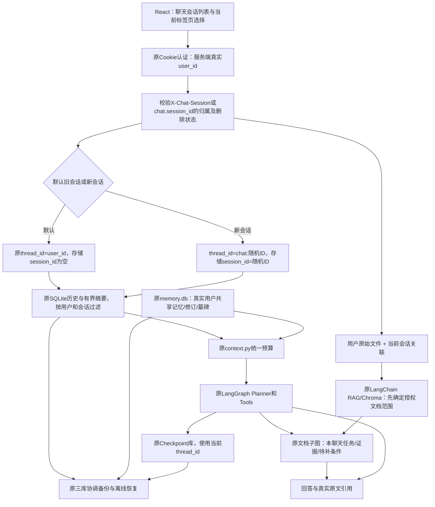

# 第五阶段最终验收：跨会话与共享长期记忆

后续更新：本报告保留初次验收的失败记录。真实模型的历史计算与混合工具遗留问题现已修复并复跑通过，单元扩展到123项；Windows共享端口本次有限复验通过，但旧偶发超时未证明彻底解决。最新结果见[遗留问题修复验收](planner-repair-acceptance.md)。

日期：2026-11-24。Windows，Python3.11.4，Node24.18.0，React19.2.8，本机Ollama。按“最小方案→相关用例→统一回归”实施；没有提交Git、推送、创建公网入口或开展无关重构。原有其他阶段的工作区改动保留。

## 最小方案与交付范围

此前 `thread_id=user_id`，历史、摘要、当前任务及文件范围事实上按身份共用。本轮在原框架上增加独立聊天会话，并区分两个概念：

- **认证会话**：原Cookie与sessions表，决定真实用户身份；完全复用。
- **聊天会话**：conversations表，服务端生成随机32位ID，决定本次聊天的数据范围。

用户不能通过session_id、user_id、文件ID、任务ID获得他人数据。不同聊天的历史、摘要、Checkpoint、当前任务和附件关联隔离；MemoryStore继续按真实用户共享已有规则筛选出的姓名、职业、爱好等事实。没有引入第二个Agent、第二套记忆库、重复上传系统或新的依赖。

## 架构



服务端请求作用域使用ContextVar传递，进入作用域前按Cookie身份查询归属；LangGraph执行线程中仍受同一文档范围约束，已专门验证乙会话的自动知识库路由不能读到甲的文件。内部索引后台没有聊天作用域，可按真实用户重建全部派生索引，但查询接口必须先取得当前聊天授权范围。

## API与前端

| 方法 | 接口 | 行为 |
| --- | --- | --- |
| GET | /conversations | 当前真实用户的会话列表，含deleted、is_default等公开信息 |
| POST | /conversations | 严格JSON `{"name":"项目甲"}`，名称1–60字符；服务端生成ID |
| DELETE | /conversations/{id} | 软删除；JSON Content-Type和现有Origin规则；不物理删数据 |
| POST | /conversations/{id}/restore | 严格空JSON `{}`，恢复原会话及原内部thread键 |

聊天、历史、附件、任务和检索请求使用 `X-Chat-Session: <聊天ID>`。POST /chat也支持可选session_id；头/体不一致409，伪造/他人/已删除会话404。未提供ID时使用兼容默认会话。`user_id`始终来自服务端Cookie，不由会话参数替代。其他旧API格式保持，旧客户端可继续使用默认聊天。

侧栏复用原样式，新增名称输入、新建、切换、删除、显示已删除及恢复。当前选择存在标签页sessionStorage；刷新前先取得服务端授权列表，只有仍归本人且有效的ID才会选用，否则回到默认。登录/退出清理旧选择；另一个浏览器可从列表打开同一聊天，各标签页不会被服务端全局active变量互相切换。

切换提升原前端epoch、清理历史/附件/任务/原文面板/草稿及请求ID，旧响应丢弃；附件轮询额外核对发出请求时的会话ID。记忆面板仍是用户级，切换时关闭以避免旧请求展示。修正了自动滚动把页面顶端带出视口的问题：现在只滚动聊天容器；侧栏内容可独立滚动，桌面与390像素窄屏已验收。

## 兼容迁移与数据保护

原app.db增量迁移8，无聊天ID重排、无文件复制、无Checkpoint库重建、无memory.db结构修改：

| 数据 | 变更及旧数据归属 |
| --- | --- |
| conversations | 新增会话元数据，真实user_id、随机公开ID、thread_id、存储session_id、名称、创建时间与软删除标记 |
| chat_messages | 新增session_id；旧记录为空字符串，代表旧默认聊天，原ID/角色/正文保留 |
| history_summaries / history_summary_revisions | 原主键user_id重命名为thread_id；增加真实user_id与session_id；旧主键仍为原用户ID，旧修订和来源不变 |
| schedule_tasks | 同样保留旧主键为thread_id，补真实用户与会话；旧默认任务不丢失 |
| agent_tasks | 增加session_id，列表、选择与写入校验当前会话；任务ID仍由服务器生成 |
| chat_requests | 原主键用户部分保留为thread_id，增加真实用户/会话，避免两个聊天的相同request_id互相重放 |
| conversation_documents | 新增用户/会话/文件关联；迁移把已有文件关联到旧默认聊天 |

默认会话元数据按真实用户首次访问时幂等创建；原数据的存储空会话键与Checkpoint键不变。重复启动不会重复导入旧JSON历史或重复关联文件。沿用各初始化入口事务迁移；失败可回滚当前事务并重启补齐，不声称整个启动只有一个跨模块事务。故障注入测试验证了旧列/消息在拒绝DDL后仍完整，解除故障可重试。

旧默认会话本版作为兼容入口保留不可删除；新会话可以软删除和恢复。会话总量上限100（含默认和已删除）。删除不清除原聊天、摘要修订、Checkpoint、文档任务、文件关联或备份，也**不删除用户共享长期记忆**；要忘记个人事实请在记忆管理中删除。本人可在用户级记忆面板审计来自其他聊天的记忆来源，不等于其他聊天原文被自动送入当前模型。

同用户同文件名/内容重新上传只新增会话关联，解析、原文与用户级向量索引复用。移除某一聊天的关联，不会删除其他聊天的文件；最后一个关联移除后才走原物理清理与向量失效流程。软删除聊天的文件关联仍保留，以便恢复。原12个独立文件/180000文本字符限额仍按用户总量计算，不是每聊天复制一份配额。

升级必须停止全部旧Worker、按原方法完整备份、统一启动新代码。旧写进程不能与新列/键设计混跑。原备份包含三个SQLite库，因此会话元数据、关联、历史、任务、摘要、共享记忆及Checkpoint一起进入已有一致性边界；Chroma仍是可重建派生数据，不能将分开复制向量目录称为一致快照。恢复仍要求离线，恢复后重新登录并重建失效索引。

## 实际测试结果

核心测试均使用虚构信息、独立临时库和临时Edge配置；没有读取个人PDF或用个人业务库做迁移演练。

| 测试 | 结果 |
| --- | --- |
| 原有基线 | 前小阶段101/101已通过；本轮先运行29项相关记忆/摘要单元和上下文API，再实施其余验收 |
| 最终完整单元 | **109/109通过，12.704秒**，新增8项；原101项继续通过 |
| 新单元 | 旧迁移/重复执行保留数据、默认/新thread键、归属及软删除恢复、默认兼容保护、并发默认创建、作用域异常恢复、问题不误写记忆、DDL故障回滚及重试 |
| 新会话API验收 | 创建/切换/删除/恢复、跨账号拒绝、头体冲突、旧默认隔离、跨浏览器登录、历史/摘要/Checkpoint、共享姓名、文件/任务ID越域拒绝、文件关联去重与移除、双路径RAG、request_id隔离、三库恢复通过 |
| 重启恢复 | 两次独立进程：甲会话检索后注入计算故障，重启登录后同任务只重做calculator并复用引用；乙会话无甲文件/任务；两个Checkpoint键分别恢复，通过 |
| 双进程 | 独立端口、同数据目录、不同真实PID；原摘要协调及新会话历史/切换/并发互斥/删除恢复可见性通过。并发同身份请求仍可能409；不是吞吐测试 |
| 新Edge流程 | 新建/切换、共享记忆、独立文件、迟到原文响应丢弃、删除/恢复、刷新、访客身份切换、桌面1280×900/窄屏390×844通过 |
| 旧浏览器流程 | auth_browser、memory_management_browser、history_summary_browser通过；真实Ollama+embeddinggemma的自动RAG PDF/DOCX上传→READY→问答→引用→原文通过 |
| 工程检查 | 前端lint无警告、生产构建通过；pip check无冲突，git diff --check通过 |

统一离线回归通过的入口：auth_evaluation、account_management_evaluation、context_evaluation、model_prompt_evaluation、planner_evaluation、chat_routing_evaluation、concurrency_backup_evaluation、attachment_evaluation、attachment_contracts、abstract_evaluation、network_evaluation、advanced_evaluation、document_preparation_evaluation、rag_planner_evaluation、rag_fault_evaluation、memory_metadata_evaluation、memory_management_evaluation、history_summary_evaluation、vector_index_evaluation。覆盖原普通聊天、时间/计算/工具依赖、文档摘要缩写、版本工期、故障续跑、文件边界、来源引用、记忆墓碑、索引失败/重启/重建和备份恢复。

### 真实模型：通过与未通过分别记录

Qwen2.5:7b的跨聊天实测通过：甲声明“我叫李四”及私有代号蓝杉；乙能使用共享姓名，但对另一个聊天的代号回答“不知道”；回到甲可回忆蓝杉。精确算式“1+4=?”通过程序计算，并检查Checkpoint中calculator已执行。

**未通过/未验证为工具成功的两项：**

1. 在姓名/代号历史后提出“先计算100+200，再将结果乘以3”，模型虽答900，却选择普通聊天，执行记录未形成两步。测试明确输出 `REAL_DEPENDENCY_TOOL_VALIDATED False`，不能把正确数字当作工具链通过。
2. 单独运行原真实Planner回归，首次两步计算300→900通过（3.280秒）；接着“查询当前时间，并计算2+3”失败：time完成，第二步failed_validation，后续停止。原断言因失败记录没有tool键而KeyError；仅补充状态断言后，失败原因正确显示为参数/计划校验拒绝。**整条真实混合工具回归未通过**，没有修改生产Planner以掩盖失败，也没有无限重复模型测试。

这两项是实际可靠性限制，应后续单独改进Planner意图和参数反馈；不阻塞会话作用域交付，但本轮不能宣称全部真实模型回归通过。

## 性能样本

单机一次或两次观察，不是压测、并发吞吐或公网SLA。TestClient计时不含真实公网往返，真实Ollama请求计时包含后端与模型流程，不等于纯模型推理时间。

| 样本 | 实测 |
| --- | --- |
| 模块已导入后的FastAPI lifespan启动 | 128.84毫秒 |
| 创建两个聊天 | 68.15毫秒 |
| 空聊天历史接口 | 20.94毫秒 |
| 替身Embedding + 真实本地Chroma检索 | 9.37毫秒 |
| 替身回答模型RAG整请求 | 121.76毫秒 |
| 协调三库备份 | 75.66毫秒 |
| 新会话离线综合API验收 | 4.399秒 |
| 真实模型甲声明姓名，最终采样 | 7.074秒；另一次采样1.153秒，不能将差异简单都归于推理 |
| 乙读取共享姓名 | 1.325秒 |
| 乙不知道甲私有代号 | 0.694秒 |
| 甲回忆自身代号 | 0.907秒 |
| 精确算式确定性计算 | 0.092秒，无需模型生成计算结果 |
| 最终真实跨聊天脚本7次请求整体 | 13.195秒，另一采样7.046秒；包含上述未形成工具链的多步回答，脚本最终断言失败，不按“全通过性能”宣传 |

## 非阻塞问题与剩余边界

- **Windows共享监听 `--workers 2`** 是前小阶段已出现的超时，按要求单独保留；本轮未重新冲击该方式，没有宣称修复或通过。双进程结果仅指独立端口共享数据目录。
- 双进程测试使用替身对话模型、关闭向量后台；本轮未复测共享Chroma Server下“多Worker + 多会话 + 真实RAG”组合。真实RAG浏览器为单Worker。嵌入式Chroma仍不得多Worker共用。
- 新会话隔离不意味着同一用户的请求可并行执行：继续复用原身份锁，可能409，避免任务/记忆并发覆盖。长时间压力、跨机器部署、所有浏览器和公网未验收。
- 默认会话不可删除、100会话包含回收站、不支持永久清除/重命名/分页；从软删除聊天恢复后才能管理其附件。共享长期记忆只使用现有保守规则，不是通用项目记忆提取器。
- 其他标签页删除当前聊天后，新请求404；页面可刷新或切到其他聊天，没有新增实时推送或自动强制切换。
- 原有有损摘要、估算Token、纠正保守失效及真实模型误路由限制保留；原聊天与审计仍可能增长。OCR和真实SMTP不属于本轮，仍不能标为真实环境通过。

测试过程中记录并修复了三个相关问题：新增模块过早导入认证配置导致测试临时库断言阻止继续，改为延迟访问数据库；无问号“我叫什么”被误提取为姓名候选，增加针对性问题过滤；新会话列表令旧浏览器脚本的全局checkbox选择不再准确，改成认证面板内选择。测试隔离断言在启动迁移前阻止了错误环境继续，没有在个人库写入测试账号/聊天。没有清理已有成果。

## 启动和演示

仍是原启动方式，无新增依赖。停止旧Worker并备份后，打开本机Ollama；终端一：

```powershell
cd <LOCAL_PROJECT_PATH>
$env:MY_AGENT_MODE='local'
$env:MY_AGENT_MODEL='qwen2.5:7b'
$env:MY_AGENT_OLLAMA_URL='http://127.0.0.1:11434'
.\.venv\Scripts\python.exe -m uvicorn src.server.api:app --host 127.0.0.1 --port 8000 --workers 1
```

终端二：

```powershell
cd <LOCAL_PROJECT_PATH>
npm --prefix frontend run dev -- --host 127.0.0.1 --port 5173 --strictPort
```

打开 http://127.0.0.1:5173 注册/登录/访客 → 新建“项目甲” → 声明虚构姓名与代号、上传虚构文件 → 新建“项目乙” → 验证无甲历史/文件，但可使用共享姓名 → 切回甲 → 删除甲、显示已删除并恢复 → 刷新确认。记忆管理是全用户共享入口；删除会话不等于忘记个人记忆。

可重复验收命令：

```powershell
.\.venv\Scripts\python.exe -X utf8 -m unittest discover -s tests -p "test_*.py" -q
.\.venv\Scripts\python.exe -X utf8 -m tests.conversations_evaluation
.\.venv\Scripts\python.exe -X utf8 -m tests.conversations_evaluation --restart
.\.venv\Scripts\python.exe -X utf8 -m tests.conversations_evaluation --ollama
.\.venv\Scripts\python.exe -X utf8 -m tests.conversations_workers_evaluation
npm --prefix frontend run lint
npm --prefix frontend run build
.\.venv\Scripts\python.exe -X utf8 -m tests.conversations_browser_evaluation
```

真实跨聊天脚本分别报告核心隔离/共享/计算器子项与多步工具验证布尔值；为避免将False误当整体验收通过，依赖验证为False时脚本最终断言失败。原混合工具回归可用 `tests.planner_evaluation --ollama`复现其失败，不宜无限重试。浏览器截图保存在忽略目录 `.demo-runtime/conversations-ui`。

## 本轮文件清单

新增6个：src/server/conversations.py、tests/test_conversations.py、tests/conversations_evaluation.py、tests/conversations_workers_evaluation.py、tests/conversations_browser_evaluation.py、本文。

修改18个：src/server/api.py、migrations.py、history.py、schedule_tasks.py、request_log.py、documents.py；src/agent/history_summary.py、state.py；src/memory/extractor.py；src/retrieval/service.py；frontend/src/App.jsx、App.css、frontend/vite.config.js；tests/auth_browser_evaluation.py、history_summary_workers_evaluation.py、planner_evaluation.py；README.md、docs/local-evaluation.md。

没有重写Planner或工具，没有更改长期记忆结构，没有删除旧数据、提交Git或推送。代码和文档已保存，等待最终验收。
