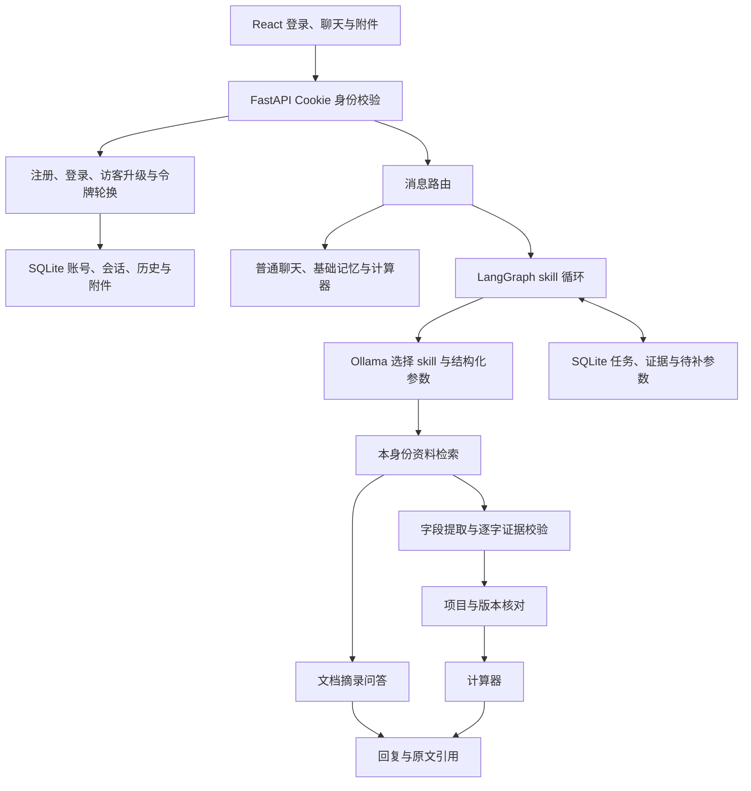

# 历史 README（第一至第六阶段）

本文件保留整理前的项目说明与阶段记录。当前启动、能力和限制以[仓库 README](../README.md)为准；历史测试不表示本轮重新验收。

---

# 🤖 My-Agent 智能 Agent 系统

基于 **FastAPI、LangGraph、SQLite、React 和本机 Ollama** 的本地 Agent 项目。支持自由聊天、计算、上传文件问答、带依据的工期分析，以及注册登录和任务中断恢复。

📈 当前版本 **v1.3.0**，支持上传文件分析、多阶段排程、综合摘要、多任务、Excel、账号管理和协调备份。页面已移除工作日历和内置演示资料加载入口。核心运行使用本机模型，首次安装依赖和下载模型需要联网。

---

## ✨ 核心功能

🛡️ 第六阶段最小稳定性修复：聊天请求共用协作式总预算，默认 180 秒，可在后端启动前设置 `$env:MY_AGENT_REQUEST_SECONDS = '180'`（大于 0、不超过 3600）。已进入的同步调用等待实际返回，超时后停止后续步骤；失败和超时请求不会通过相同 `request_id` 自动重放。数据库异常保留结果未知的保护状态。无需新依赖、数据库结构迁移或前端重建，重启后端生效。测试、文件清单及恢复边界见[第六阶段稳定性验收](../docs/stability-stage6.md)。

| 功能 | 当前能力 |
| --- | --- |
| 🔐 注册与登录 | 注册登录、修改密码、设备撤销、退出所有设备；邮箱验证与找回支持可配置邮件服务 |
| 👤 访客体验 | 显式进入访客会话，注册时可选择保留本次资料与聊天 |
| 💬 自由聊天 | 普通对话、近期上下文、基础画像记忆和计算器 |
| 🗂️ 多个聊天会话 | 同账号独立历史、摘要、Checkpoint、附件与任务；共享筛选后的长期记忆，可软删除和恢复 |
| 🧠 长期记忆管理 | 查看来源与修订、分类浏览、编辑、软删除，以及暂停/开启自动记忆 |
| 🗒️ 有界历史摘要 | 对较早完整轮次保留有来源的背景、决定和约束；增量更新、失败回退，原聊天不删除 |
| 📎 文件上传 | UTF-8 TXT、Markdown、DOCX、XLSX、文字 PDF；扫描 PDF 可选本地 OCR |
| 📖 文档问答 | 检索当前聊天关联的附件，按问题返回带证据的事实、推断与摘录，支持分批汇总 |
| 🧮 工期分析 | 核对版本与证据，支持多任务依赖图、并行路径、工作日历和关键路径 |
| 🔗 多轮追问 | 沿用已确认的项目、证据与计算口径，支持补充项目、版本和延后量 |
| 🔄 中断恢复 | 多个任务独立保存证据与已完成步骤，切换、暂停及重启后可继续 |
| 🌐 访问方式 | 本地 Vite 开发入口，或 Demo 静态前端配合 Cloudflare Tunnel 临时公网入口 |

---

## 🚀 安装与启动

### 1. 首次安装

准备 Python 3.11、Node.js/npm 和 Ollama。本项目已在 Windows、Python 3.11.4、Node.js 24.18.0 上测试。

在 PowerShell 中执行以下命令，仓库已有虚拟环境时可跳过创建步骤。

```powershell
cd <LOCAL_PROJECT_PATH>
py -m venv .venv
.\.venv\Scripts\python.exe -m pip install -r requirements.txt
npm --prefix frontend ci
ollama pull qwen2.5:7b
```

更新代码后，如果 requirements.txt 或前端依赖发生变化，再执行对应安装命令。

### 2. 每次开机后启动本地演示

从 Windows 开始菜单打开 **Ollama**。可执行以下命令，确认能连接服务且已安装模型。

```powershell
ollama list
```

随后打开两个 PowerShell 终端。

**终端一启动 FastAPI 后端。**

```powershell
cd <LOCAL_PROJECT_PATH>
$env:MY_AGENT_MODE = 'local'
$env:MY_AGENT_MODEL = 'qwen2.5:7b'
$env:MY_AGENT_OLLAMA_URL = 'http://127.0.0.1:11434'
.\.venv\Scripts\python.exe -m uvicorn src.server.api:app --host 127.0.0.1 --port 8000 --workers 1
```

看到 Application startup complete，且没有随后出现的端口错误，表示后端启动成功。

**终端二启动 Vite 前端。**

```powershell
cd <LOCAL_PROJECT_PATH>
npm --prefix frontend run dev -- --host 127.0.0.1 --port 5173 --strictPort
```

浏览器打开 [本地页面](http://127.0.0.1:5173)。保持 Ollama 和两个终端运行，结束演示时分别按 Ctrl+C。后端代码更新后需重启后端，前端可刷新页面获取最新界面。

### 3. 注册、登录或进入访客模式

首次打开页面，可选择注册账号、登录已有账号，或进入新的访客会话。

| 项目 | 规则 |
| --- | --- |
| 用户名 | 3–32 位英文字母、数字、下划线，进行 NFKC 规范化和大小写折叠 |
| 密码 | 10–128 个字符，保留空格，使用 Argon2id 哈希存储 |
| 保留访客数据 | 当前访客注册时可勾选“保留本次访客资料与聊天” |
| 空账号开始 | 未勾选保留时创建新的内部身份，原访客数据保持原有归属 |
| 登录已有账号 | 加载该账号的历史、附件和任务 |
| 退出 | 当前登录令牌立即失效，其他已登录设备继续有效 |

选择保留时，原访客身份升级为账号，聊天、附件、长期记忆、任务和 checkpoint 沿用同一个内部 ID。账号创建和令牌轮换在同一事务中完成。

手动切换身份会清理旧身份的页面数据与草稿。会话过期时提示重新登录，重新登录同一账号后可恢复尚未发送的草稿。前端丢弃旧身份延迟返回的响应。

注册响应丢失时，账号可能已经创建，可以使用同一用户名密码登录。原访客数据在未保留时仍在数据库中，当前没有重新认领这些数据的界面。

---

## 💬 聊天与文件分析

### 三种回答模式

| 模式 | 使用方式 |
| --- | --- |
| 自动 | 根据当前消息与近期对话判断是否需要附件，独立算式进入计算流程 |
| 自由聊天 | 使用聊天上下文和基础记忆，保留已有附件任务 |
| 文件问答 | 明确结合当前身份上传的资料回答 |

可以直接发送“你好，请介绍一下你自己”或“1+4=?”。上传附件后仍可自由聊天，之后也可继续文件任务。

### 🧠 管理长期记忆

登录或进入访客会话后，点击侧栏 **“长期记忆”**。先在自由聊天中发送虚构信息“我叫李四”，再打开管理面板，即可查看类别、来源、创建/更新时间、确认状态和修订号。选择记忆后可编辑，保存会生成新修订；并发冲突时保留输入，点击“重新载入”核对后再编辑。

删除前需勾选“我了解删除范围”。删除立即停止将该条目作为有效长期记忆读取，但**不删除原始聊天、审计、修订和备份**；近期对话仍可能含有原话。“显示已删除”可查看逻辑删除记录，界面不提供直接恢复按钮。

关闭“自动记忆”后不再从新聊天自动提取或写入长期记忆，已有记忆仍可使用，手动编辑/删除、普通聊天、工具与 RAG 均继续工作。重新开启不会补写暂停期间的聊天。开关按服务端身份保存，同账号不同设备共享；访客注册并保留资料时沿用原身份和设置。

本次无新增依赖。停止全部旧后端并做好原三库备份后，用上面的原命令重启后端和 Vite；Demo 静态页面需先执行 `npm --prefix frontend run build` 再重启。原 memory.db 自动进行版本2增量迁移，不清空旧记忆、不改变聊天历史结构，不支持新旧写进程混跑。详细 API、文件清单、测试与边界见 [第五阶段第三小阶段验收](../docs/memory-stage5-3.md)。

### 正常演示

1. 登录或进入访客会话，点击“添加文件”，选择 [plan.txt](../tests/fixtures/plan.txt) 和 [change.md](../tests/fixtures/change.md)，等待解析完成。
2. 发送“总结这些文件中的主要变更，并标注依据”，查看相关原文摘录，点击引用按钮核对。
3. 发送“根据最新批准的变更，计算剩余工期”，预期选中星港项目已批准 V2，得到 **4 + 11 + 0 = 15 个工作日**。
4. 刷新页面，再发送“第二阶段再延后一周呢”，沿用 V2 和每周五个工作日口径，预期得到 **20 个工作日**。
5. 退出再登录，检查附件与历史恢复。同一账号在另一浏览器登录也可恢复，其他账号与访客的数据相互隔离。

文件分析只使用当前身份上传的资料。内置演示加载入口与接口已移除，没有附件时提示上传；旧内置演示任务不再读取默认文件。仓库虚构样本仅保留为离线测试夹具，不会自动加载。

添加、删除资料后，旧任务发送“继续任务”会提示旧证据失效，再次发送“继续任务”重新检索。完整的新需求可以创建新任务。

### 文件支持范围

| 项目 | 上限或说明 |
| --- | --- |
| 文件类型 | UTF-8 TXT、Markdown、XLSX、PDF（OCR 依赖可选） |
| 文件大小 | 每文件 5 MiB |
| 解析文本 | 每文件 60000 字符，每身份合计 180000 字符 |
| 文件数量 | 每身份 12 个 |
| PDF 页数 | 最多 80 页 |
| 单行长度 | 最多 1800 字符，超长行需先分段 |
| 引用位置 | 文本行号，或 PDF 页码与页内提取文本行号 |

扫描 PDF 需要本机 Tesseract 与 Poppler，缺失时返回安装提示；加密 PDF 暂不支持。PDF 行号以解析或 OCR 结果为准，OCR 数字需要核对后才能计算。

原文件与解析段落使用服务端生成的随机文件 ID 一起保存，原文件名仅作展示。同名同内容重复上传复用 ID，失败文件不会成为可检索条目。接口按服务端身份校验归属。

刷新后保留附件、聊天和最近任务引用。更早回答保留文字引用，可从附件列表查看原文。删除资料后，对应历史引用按钮会返回文件不存在。

---

## 🆕 本地扩展演示

### 上传资料后的工期分析

上传 [network-plan.md](../demo_files/network-plan.md)，发送“计算剩余工期”。资料中第一阶段剩余二天，第二阶段五天、第三阶段三天均依赖第一阶段，预期剩余 **7 个工作日**，一条关键路径为第一阶段 → 第二阶段。

页面已移除工期工作日历，直接上传资料并提问即可。后端原有排程与日历参数暂保留兼容历史任务和离线测试，不再提供日历配置界面。

发送“第二阶段再延后一周呢”，多阶段任务会确认是“增加时长”还是“推迟开始”。前者增加工作量，后者推迟当前计划中的最早开始。周数按当前工作周长度换算，未配置日历时采用五个工作日。原两阶段任务保留原有增量口径，并在回答中标注用户假设。

计算最多支持 200 项任务。循环依赖、缺失依赖、重复任务、负工期和统计日期冲突会阻止计算。原文必须能确认剩余量与依赖关系，资源争用与小时级排程仍需另行建模。当前证据绑定仍要求能识别“阶段名称…剩余…工作日”等明确措辞，不保证任意自然语言均能提取；“一百一”等歧义数量需改为完整数量或阿拉伯数字。

### 综合摘要与多个任务

发送“总结所有文件”或“对比变更”，模型会归纳有依据的事实与推断，并展示原文片段。超长资料每批最多四个片段、7000 字符，批次结果逐步保存，达到本轮上限后发送“继续任务”。分批完成后逐对合并已验证的摘要文本，输出跨批次综合推断，并保留各批事实、引用及覆盖范围。综合结论与冲突仍需结合原文复核。

侧栏“＋ 新任务”建立独立任务，列表显示当前选择及状态。切换任务后可以继续追问，执行记录展示已完成的检索、提取、汇总与计算步骤。暂停作用于稳定的轮次边界。普通聊天保留任务，重启后从数据库恢复。

选择已有任务会沿用其保存的附件范围。新增资料需要发送“重新检索”确认范围更新；删除已使用资料会使旧证据失效，并清除旧延后假设与 OCR 确认。

### Excel 与扫描 PDF

XLSX 解析保留工作表、单元格区域、数字、日期、公式与缓存值。引用可定位到“工作表名!A2:C2”。公式缓存可能缺失或过期，应用不执行公式重算、宏或外部链接。单工作簿最多 20 个工作表、10000 行、200 列和 50000 个遍历单元格，ZIP 展开总量最多 30 MiB。复杂文件解析使用独立子进程，整体上限 60 秒。

扫描 PDF 使用本机 Poppler 渲染和 Tesseract OCR，缺少工具时提示安装，其他解析功能继续可用。OCR 片段标记页码和识别来源，工期计算前需核对并回复“确认OCR数字”。可在启动后端的终端中配置以下变量，路径替换为实际安装位置。

```powershell
$env:MY_AGENT_TESSERACT = 'C:/Program Files/Tesseract-OCR/tesseract.exe'
$env:MY_AGENT_PDFTOPPM = 'C:/tools/poppler/bin/pdftoppm.exe'
$env:MY_AGENT_OCR_LANG = 'chi_sim+eng'
```

本机已验收 OCR 调用接口、来源标记和依赖缺失路径；真实识别需要安装 Tesseract 及对应语言包后复测。先安装包含 `chi_sim.traineddata` 的 Tesseract 和提供 `pdftoppm.exe` 的 Poppler，使用上面的绝对路径配置；执行 `& $env:MY_AGENT_TESSERACT --list-langs` 确认含 chi_sim 与 eng，再重启后端并上传虚构扫描件。本项目不会自动下载安装 OCR 引擎。

### 账号管理与邮件配置

已登录用户可打开“账号管理”，验证当前密码后修改密码、查看登录设备、撤销其他设备或退出全部设备。修改密码撤销旧会话并为当前设备签发新令牌；重置密码撤销全部会话。

邮箱绑定需验证当前密码，并使用邮件中的单次令牌确认。找回密码仅面向已验证邮箱，响应统一，发送放在后台执行。令牌十五分钟有效、数据库只保存哈希，使用后失效。邮箱变更和密码修改会清理相关证明令牌。

真实邮件服务由运行者配置，应用使用 STARTTLS。以下仅为配置项，凭据应放在本机环境或被忽略的 .env 中。

| 变量 | 用途 |
| --- | --- |
| MY_AGENT_SMTP_HOST | SMTP 主机 |
| MY_AGENT_SMTP_PORT | 端口，默认 587 |
| MY_AGENT_SMTP_FROM | 发件地址 |
| MY_AGENT_SMTP_USER | 可选认证用户名 |
| MY_AGENT_SMTP_PASSWORD | 认证密码 |

本次没有配置 SMTP 或发送真实邮件。邮箱验证与密码找回通过本地邮件替身验收。未配置服务时，绑定邮件会明确报错，找回接口仍返回统一接受提示；用户可继续使用其他账号功能。

### 多进程协调与备份恢复

请求使用共享 SQLite 租约协调，同一身份的写操作互斥，正常执行每十秒续租，异常退出后最多等待九十秒过期。新前端为聊天生成请求 ID，相同 ID 与内容返回已完成结果，改变内容会拒绝；中途退出的请求需用新消息“继续任务”核对。最近七天的完成记录参与去重，每身份最多保留 1000 条请求记录。

两个真实 Uvicorn worker 已通过共享登录、历史、checkpoint、附件工期与追问验收。默认启动仍为单 worker，长期压力和多进程登录限速尚待完善。

所有服务先升级到当前代码，再使用一致性备份命令。备份会先建立维护屏障，只有当前无请求执行时才开始，然后复制三个数据库并生成校验清单。备份期间的新请求返回维护提示；如果已有请求，命令要求稍后重试。

在仓库根目录备份 Local 数据，可使用一个尚不存在的新目录。

```powershell
$env:MY_AGENT_MODE = 'local'
.\.venv\Scripts\python.exe -m src.server.backup backup .demo-runtime/backups/snapshot-20261123
```

恢复前停止所有 worker，保持相同模式配置。

```powershell
.\.venv\Scripts\python.exe -m src.server.backup restore .demo-runtime/backups/snapshot-20261123 --confirm-restore
```

恢复校验清单后覆盖账号、历史、附件、任务、记忆和 checkpoint。旧会话及邮件令牌会被撤销，重新登录即可访问恢复的数据。需要恢复后继续访问的访客资料，应先注册并选择保留资料再备份。普通失败会回滚；恢复中断会留下 restore_pending.json，新后端会拒绝启动，需要停止服务并重新执行恢复。异常退出后需等待维护租约到期。旧 JSON 留作备份，迁移后的历史以 app.db 为准。

Demo 备份应沿用该 Demo 的环境变量和数据目录。不要混用 Local 与 Demo 的备份配置。协调数据库只保存运行时租约，不属于需恢复的业务数据。

---

## 🏗️ 系统架构与 Skill



| Skill | 执行流程 | 允许工具 |
| --- | --- | --- |
| document_qa | 按问题检索资料，选择证据并综合归纳、对比变更，区分事实、推断与用户假设 | document_search |
| schedule_analysis | 检索、提取带证据字段、核对项目版本、计算工期 | document_search、calculator、project_schedule |

注册定义位于 [skills.py](../src/agent/skills.py)。模型选择 skill 与检索参数，后端校验名称、参数和工具白名单。文档内容作为资料处理，执行权限由后端控制。模型 JSON 或证据无效最多重试一次，仍失败则暂停；工期与文档流程每轮最多六步。

检索采用本地关键词排序，每轮最多 24 段、22000 字符。文档问答超过范围时说明覆盖限制，工期任务超过范围时要求缩小资料范围。总结、对比和变更问题对全部附件分批处理，每批结果与证据持久化，达到轮次上限后发送“继续任务”；跨批次合并结果标记为推断，分批结论保留各自依据；合并输入仅来自通过引用校验的输出。

---

## 🔄 任务中断与恢复

1. 停止本地后端，在原终端设置开关，再用本地后端启动命令运行。

   ```powershell
   $env:MY_AGENT_FAIL_CALCULATOR_ONCE = '1'
   ```

2. 上传正常演示中的两份资料，发送“计算剩余工期”。检索和提取完成后，计算器发生一次注入故障。
3. Ctrl+C 停止后端，再启动。保持同一身份，发送“继续任务”，复用已保存的证据与字段，只补做计算，得到 15 个工作日。
4. 清理开关并重启后端。

   ```powershell
   Remove-Item Env:MY_AGENT_FAIL_CALCULATOR_ONCE
   ```

开关仅在 Local 模式生效，每个新任务可注入一次。每个身份可保存多个任务，侧栏选择决定当前追问目标。工具返回与状态提交之间退出时，可能重做只读步骤。任务与聊天历史分开提交，计算已提交而回复未显示时可发送“继续任务”，避免重复发送增量延后条件。

---

## 🌐 本地与公网演示

| 方式 | 终端一 | 终端二 | 访问地址 |
| --- | --- | --- | --- |
| Local | FastAPI，8000 | Vite，5173 | http://127.0.0.1:5173 |
| Demo | Cloudflare Tunnel | FastAPI，8001，同时提供构建后前端 | 本次生成的 HTTPS 地址 |

公网演示也需要本机 Ollama 运行。先在仓库根目录构建前端。

```powershell
cd <LOCAL_PROJECT_PATH>
npm --prefix frontend run build
```

终端一运行 Tunnel，复制输出中以 https:// 开头、trycloudflare.com 结尾的地址。出现 Registered tunnel connection 后确认隧道已连接。

```powershell
cloudflared tunnel --url http://127.0.0.1:8001 --protocol http2 --no-autoupdate
```

终端二运行以下配置，将 PUBLIC_ORIGIN 的值替换为本次真实地址，末尾省略斜杠。

```powershell
cd <LOCAL_PROJECT_PATH>
$env:MY_AGENT_MODE = 'demo'
$env:MY_AGENT_PUBLIC_ORIGIN = 'https://替换为本次地址.trycloudflare.com'
$env:MY_AGENT_DEMO_DATA_DIR = '<LOCAL_PROJECT_PATH>
$env:MY_AGENT_MODEL = 'qwen2.5:7b'
$env:MY_AGENT_OLLAMA_URL = 'http://127.0.0.1:11434'
.\.venv\Scripts\python.exe -m uvicorn src.server.api:app --host 127.0.0.1 --port 8001 --workers 1
```

打开本次公网地址确认可用后分享。保持电脑开机、联网、避免休眠，并保持 Ollama、后端和 Tunnel 运行。重新创建 Tunnel 后地址可能变化，需要同步修改 PUBLIC_ORIGIN 并重启后端。

Local 与 Demo 使用不同数据库，账号和资料分别保存。v1.2.0 的 Demo HTTPS 接口已做本机测试，新增认证功能尚未通过真实公网入口复测。

---

## 🔐 身份验证与数据存储

认证接口为 POST /auth/register、POST /auth/login、POST /auth/logout 和 GET /auth/me。后者返回 anonymous、guest 或 account 身份类型。数据归属由服务端 Cookie 解析出的不可变用户 ID 决定。

密码使用 Argon2id 随机盐哈希，会话令牌随机生成，数据库保存 SHA-256 摘要。登录轮换当前令牌，Cookie 为 HttpOnly、SameSite=Lax、Path=/，Demo HTTPS 模式额外使用 Secure。修改状态接口检查 Origin，JSON 接口同时校验内容类型。

注册、登录及相关敏感账号操作按连接端来源地址计数，每五分钟最多八次尝试，包括成功尝试。内存最多保留 4096 个来源，重启清空，多 worker 分别计数。代理可能让多个用户共享计数桶。

| 数据 | Local | Demo |
| --- | --- | --- |
| 账号、会话、历史、附件、任务 | data/local_sessions.db | 专用目录下 app.db |
| 长期记忆 | data/memory.db | 专用目录下 memory.db |
| LangGraph checkpoint | 启动工作目录下 agent_checkpoints.db | 专用目录下 agent_checkpoints.db |

使用仓库根目录启动后端，保持 checkpoint 路径一致。原始附件也保存在数据库中，备份时包含这些数据。

| 环境变量 | 用途 |
| --- | --- |
| MY_AGENT_MODE | local 或 demo，默认 local |
| MY_AGENT_MODEL | 本机模型名，默认 qwen2.5:7b |
| MY_AGENT_OLLAMA_URL | 模型服务地址，本机示例 http://127.0.0.1:11434 |
| MY_AGENT_SESSION_SECONDS | 会话有效期，默认七天，范围 60–2592000 秒 |
| MY_AGENT_PUBLIC_ORIGIN | Demo 的 HTTPS origin |
| MY_AGENT_DEMO_DATA_DIR | Demo 专用绝对数据目录，与 Local 数据分离 |
| MY_AGENT_FAIL_CALCULATOR_ONCE | Local 故障演示开关 |

项目读取根目录 .env，进程中显式设置的环境变量优先。

---

## 💾 数据迁移与备份

首次启动当前后端时自动检查并执行版本化事务迁移，进度记录在 schema_migrations。

| 迁移 | 行为 |
| --- | --- |
| 版本 1 | 保留旧 sessions，允许同一身份多个会话，创建 accounts |
| 版本 2 | 统一 SQLite 聊天存储，导入 Local 的 chat_history.json，保留原身份与消息顺序 |
| 版本 3 | 保留旧任务快照，建立多任务表与修订号 |
| 版本 4 | 账号邮箱、设备会话和单次证明令牌 |
| 版本 5 | 聊天请求去重记录 |

旧 JSON 保留作备份，迁移后停止写入。Demo 继续使用原 SQLite 历史。重复启动不会重复导入，长期记忆与 checkpoint 沿用原 ID。

旧 JSON 格式错误时导入事务回滚，启动报错。停止后端，保存副本并修复 JSON 后重新启动即可重试。注册账号时保留访客数据也采用事务处理，响应丢失可通过登录恢复。

更新前停止所有写入，备份同一批数据到独立目录。

- Local 备份 data/local_sessions.db、data/memory.db、agent_checkpoints.db，以及仍存在的 chat_history.json。
- Demo 备份专用目录下的 app.db、memory.db、agent_checkpoints.db。

服务完全停止且数据库干净关闭后可以复制文件。存在 SQLite 的 -wal、-shm 或 -journal 文件时，优先使用 sqlite3.Connection.backup 生成数据库备份。恢复时停止服务，恢复整批备份，并使用相应代码版本启动。旧数据库再用新代码启动时会重新迁移。

---

## 🧪 测试与验收

核心测试使用临时数据库、虚构资料与账号、替身模型。

```powershell
.\.venv\Scripts\python.exe -X utf8 -m tests.auth_evaluation
.\.venv\Scripts\python.exe -X utf8 -m tests.network_evaluation
.\.venv\Scripts\python.exe -X utf8 -m tests.advanced_evaluation
.\.venv\Scripts\python.exe -X utf8 -m tests.account_management_evaluation
.\.venv\Scripts\python.exe -X utf8 -m tests.concurrency_backup_evaluation
.\.venv\Scripts\python.exe -X utf8 -m tests.multiworker_evaluation
.\.venv\Scripts\python.exe -X utf8 -m tests.local_evaluation
.\.venv\Scripts\python.exe -X utf8 -m tests.chat_routing_evaluation
.\.venv\Scripts\python.exe -m unittest discover -s tests -v
npm --prefix frontend run lint
npm --prefix frontend run build
```

真实本机模型验收可单独执行，包含原两阶段与多阶段流程。

```powershell
.\.venv\Scripts\python.exe -X utf8 -m tests.local_evaluation --ollama
.\.venv\Scripts\python.exe -X utf8 -m tests.network_evaluation --ollama
.\.venv\Scripts\python.exe -X utf8 -m tests.summary_ollama_evaluation
```

浏览器验收使用 Windows 已安装的 Edge 无头实例、CDP 和隔离数据目录，另需测试依赖。

```powershell
.\.venv\Scripts\python.exe -m pip install websockets==16.1.1
.\.venv\Scripts\python.exe -X utf8 -m tests.auth_browser_evaluation
```

已通过认证、令牌轮换与失效、并发注册、账号隔离、旧数据迁移与回滚、附件分析、跨进程任务恢复和聊天路由测试。Edge 界面已验证注册、上传、聊天、退出、再登录、刷新恢复、延迟响应隔离及过期草稿恢复。前端 lint、构建和三项原有记忆测试通过。

2026-11-23 最终复验：单元测试 9/9、各离线回归、Edge 浏览器、真实双 worker、备份恢复和前端 lint/构建通过。本机 qwen2.5:7b 的多阶段全链路 7 → 12 工作日通过（15.571 秒），五文件跨批次摘要与引用通过（独立脚本 17.127 秒）。原两阶段真实模型套件在摘要环节失败：模型修改原文标点，连续两次引用校验拒绝，任务安全暂停；因此不能把本次真实模型验收表述为全部通过。历史成功与本次失败分别保留。完整清单、命令、边界见 [最终验收报告](../docs/final-acceptance.md) 和 [历史评测记录](../docs/local-evaluation.md)。

---

## 📂 项目结构

| 路径 | 职责 |
| --- | --- |
| frontend/src/ | 登录、聊天、资料栏与引用查看 |
| src/server/ | API、认证、会话、数据库迁移、历史与附件存储 |
| src/agent/ | 消息路由、应用内 skill、LangGraph 流程、版本核对 |
| src/tools/ | 计算器、文件读取与本地检索 |
| src/memory/ | 结构化画像提取与 SQLite 长期记忆 |
| tests/ | 离线验收、认证与浏览器回归、虚构资料 |
| demo_files/ | 离线测试用虚构资料，不自动加载 |
| docs/local-evaluation.md | 基线与实测记录 |

---

## ❓ 常见问题

- **提示端口已占用**。在原服务终端 Ctrl+C 后重新启动，检查 Local 使用 8000/5173，Demo 使用 8001。
- **页面仍是旧界面**。刷新或 Ctrl+F5；Demo 需要先重新构建前端，再重启后端。
- **Ollama 无法连接**。打开 Ollama，执行 ollama list，检查模型名和 MY_AGENT_OLLAMA_URL。
- **登录提示尝试频繁**。等待五分钟，当前注册与登录共用来源计数。
- **公网页面可开但登录失败**。检查当前 HTTPS 地址与 PUBLIC_ORIGIN 是否一致，修改后重启后端。
- **Tunnel 显示连接失败**。确认已出现 Registered tunnel connection，再验证外部访问。
- **分析资料较慢**。模型提取多字段和证据可能耗时几十秒，处理期间避免重复提交。

---

## 📌 当前限制

工作量必须明确为剩余工作日，阶段依赖和批准版本需要原文依据。中文数字与完整年月日支持规范化，缺少年份或含义不明时需要补充。关键路径输出一条代表路径，计算结果另含关键任务及浮动时间。资源容量与小时级排程尚未实现。

综合摘要会区分事实与推断，但语义理解仍需人工核对；超长资料分批处理后合并为综合推断，跨批次冲突仍需结合各批证据复核。多任务暂停发生在请求轮次之间，正在执行的同身份请求需先结束。新客户端使用请求 ID 防止重复提交，处理中断的相同 ID 会要求使用新的“继续任务”消息核对。

扫描 PDF 的本地 OCR 接口与替身验收已完成，本机缺少 Tesseract，真实识别与中文语言包效果未验证。Excel 公式仅展示公式与已有缓存，缓存可能过期，应用不执行重算。加密 PDF 暂不支持。

邮箱验证及找回已用本地邮件替身验收，真实 SMTP 发送未验证。双 worker 已通过共享登录、历史、checkpoint、附件分析和追问测试，长期压力测试仍待完成。反向代理来源计数和多 worker 登录限速仍有边界，详见账号配置。备份依赖所有访问都经过当前版本的协调层，恢复需要停止全部 worker。

---

## 🔮 后续方向

后续计划包括以下内容。

- 🧰 扩展文档格式、提高跨批次归纳与检索质量。
- 🧠 改进长期记忆管理与任务执行可视化。
- 🤝 改进任务管理并探索多 Agent 协作。
- 🔒 完善数据保留、代理限速与多 worker 压力验收。
- ☁️ 验证完整云端部署及持续运行能力。

---

## 👨‍💻 作者

个人 AI Agent 项目，用于学习和探索 Agent Architecture、LangGraph、Tool Calling、Memory System、FastAPI、React 与 AI Application Engineering。


### 🛠️ PDF 摘要缩写与引用修复

上传含明确“摘要/Abstract”标题的文字 PDF，选择文件问答并发送“将文件中的摘要部分，为我缩减一些”。系统定位摘要后压缩改写，正文与引用分开，点击引用查看原文；找到多个摘要时回复“选择摘要 1”，找不到时补充带标题的摘要资料后继续任务。扫描件仍依赖本地 OCR。

来源编号在每批从 0 开始明确提供，原始分块 index 不再传给回答模型。错误编号只有在当前授权批次内引文唯一匹配原文时才可纠正；错误标点、拼接、重复且无法定位的引文仍拒绝。模型错误不再要求用户补充资料，合法进度持久化后可继续。旧摘要任务首次继续会重新定位摘要，清除不适用于摘要范围的旧批次输出；其他任务不变。

```powershell
.\.venv\Scripts\python.exe -X utf8 -m tests.abstract_evaluation
.\.venv\Scripts\python.exe -X utf8 -m tests.abstract_evaluation --ollama
```

本机真实 qwen2.5:7b 已通过虚构文字 PDF 摘要缩写与引用，最终实测 8.156 秒。普通任意排版、无标题摘要及个人 PDF 未验证；不保证任意文件均能定位或理解。详见 [摘要引用修复记录](../docs/abstract-reference-fix.md)。


### 🧩 架构升级第一阶段：模型与提示模板

普通聊天与文档流程仍使用同一个 `ChatOllama` 基础实例，配置集中在 `src/agent/model_provider.py`，每个进程缓存一个基础模型。现有环境变量、90秒模型客户端超时、temperature=0及Local/Demo输出限制保持不变；修改模型环境变量后需要重启后端。文档结构化调用保留JSON Schema、8192上下文窗口、4096生成上限和最多两次格式/证据校验尝试，不修改基础模型参数。

`src/prompts/agent_prompt.py` 使用 `ChatPromptTemplate` 管理聊天与结构化请求，`MessagesPlaceholder` 保留历史角色和消息顺序。skill选择、字段提取、文档回答与归纳保留各自指令，共用结构化模板。现有 `general_agent.llm` 注入入口保留，替身模型继续可用。

本阶段不修改数据库、工具、Planner、RAG和记忆机制；不恢复默认资料或工作日历界面。启动命令、前端和依赖均不变，停止旧后端后按原命令启动即可。

```powershell
.\.venv\Scripts\python.exe -m unittest discover -s tests -v
.\.venv\Scripts\python.exe -X utf8 -m tests.model_prompt_evaluation
.\.venv\Scripts\python.exe -X utf8 -m tests.model_prompt_evaluation --ollama
```

实际基线、改造后测试和验证边界见 [第一阶段验收记录](../docs/architecture-stage1.md)。


### 🧰 架构升级第二阶段：标准工具

calculator、file_reader、time 已使用 LangChain @tool 包装，原函数仍可直接调用，注册名和结果格式保持兼容。registry.py 提供 get_tools() 获取标准工具、get_tools_info() 获取描述与严格参数schema。project_schedule仍为原内部适配器，不重复改造其他业务。

原正则Router保留，支持一条消息中多个独立算式；Planner仅转交调用列表，Executor顺序执行，最多8次，失败停止后续步骤，结果交回原Agent。本阶段不包含模型自主多步规划、工具结果依赖解析或ToolMessage循环。

file_reader保留原Local路径读取和Demo受限目录行为，只供显式授权的内部使用，未增加聊天自动路径读取。time保留原服务器本地时间语义，timezone参数暂为兼容参数，没有实现时区转换。

2026-11-24验收：后端单元16/16、model_prompt_evaluation（含实际主图多算式/下一轮清理）、聊天路由、认证、附件/摘要/跨进程恢复和多阶段工期回归通过；前端lint与构建通过。没有新增依赖、修改数据库/记忆/RAG/FastAPI或React，没有提交推送Git。未复跑本轮真实模型、浏览器、双Worker、OCR、SMTP。下一阶段再讨论标准工具消息和受控规划循环。


### 🧠 架构升级第三阶段：结构化任务规划

原LangGraph中接入Pydantic TaskPlan：普通自然语言由模型决定聊天、追问或工具计划，纯算式保留快路径。每步定义工具、参数、顺序和依赖，每轮最多8步。后端使用前置步骤真实数值替换 `$s1.result` 等引用，通过原图tool节点受控循环执行。

在“自由聊天”中发送“先计算100+200，再将结果乘以3。”，预期结果900，并展示两步计算过程。支持时间+计算等多工具协作；失败会停止后续步骤并保留记录。工具以成对AIMessage/ToolMessage传递，不把返回内容当作系统指令。没有开放模型任意读取本机路径。

```powershell
.\.venv\Scripts\python.exe -X utf8 -m tests.planner_evaluation
.\.venv\Scripts\python.exe -X utf8 -m tests.planner_evaluation --ollama
```

数据库、长期记忆、RAG、接口和React不变；重启后端即可使用。第一/二阶段的调用机制由本节渐进升级，历史验收记录保持。实际结果、文件清单和当前边界见 [第三阶段验收记录](../docs/architecture-stage3.md)。


### 📚 第四阶段·第一小阶段：文档兼容与切分准备

新增DOCX普通正文段落和表格支持，复用原上传、查看、删除和引用入口；按正文顺序提取，引用显示段落或表格行列及字符区间，不伪造Word页码。嵌套表格暂明确拒绝，页眉页脚/图片/文本框不属于本版正文提取范围。

`src/retrieval/loaders.py` 通过LangChain BaseLoader/Document适配现有安全解析器，支持TXT、PDF、DOCX、Markdown、XLSX。`load_owned_document(user_id,file_id)`复用归属检查和存储原文；未改变旧解析片段。community包已准备，但本小阶段没有用另一套解析流程替换已验证的解析器。

`splitter.py` 使用RecursiveCharacterTextSplitter，默认800字符/重叠100，保留parent_id、父文本的左闭右开字符区间和稳定chunk_id。派生片段只存在于返回值，不写回SQLite，不改变旧任务引用。字符位置相对于规范化后保存的父文本；DOCX还可定位到对应段落/单元格文本，不是原文件字节或Word分页坐标。

更新后先停止后端并安装文档依赖，再按原命令启动，前端启动方法不变：

```powershell
cd <LOCAL_PROJECT_PATH>
.\.venv\Scripts\python.exe -m pip install -r requirements.txt
.\.venv\Scripts\python.exe -X utf8 -m unittest discover -s tests -v
.\.venv\Scripts\python.exe -X utf8 -m tests.document_preparation_evaluation
```

以上为第一小阶段的历史状态：当时未安装Chroma、接入Embeddings或下载模型。本轮单元27/27、原功能回归与Edge DOCX上传/位置查看/删除通过。后续向量索引能力见下一节。详见 [第四阶段第一小阶段记录](../docs/architecture-stage4-1.md)。

### 🧬 第四阶段·第二小阶段：本地向量索引

已接入 OllamaEmbeddings + embeddinggemma（本机实测 **768维**）、Chroma 持久化。上传沿用原有入口，文件列表增加等待索引、正在索引、可检索、失败及重新索引操作。SQLite 保存原文和独立索引状态；完整写入校验通过后才发布 READY，支持幂等、失败重试、模型版本失效、宕机恢复和删除撤销。

**本阶段只建设索引和授权检索接口，聊天中的文件回答仍使用原流程，尚未接入向量 RAG 最终回答。** 查询按服务端 Cookie 身份和授权文件范围执行，并从 SQLite 复核引用位置。中文虚构测试集4文档/8问题 Top-1 8/8，不能代表任意资料效果。

首次更新先停止旧后端，然后安装依赖并准备模型：

```powershell
cd <LOCAL_PROJECT_PATH>
.\.venv\Scripts\python.exe -m pip install -r requirements.txt
ollama pull embeddinggemma
```

启动 Ollama，后端终端设置 `$env:MY_AGENT_RAG_ENABLED='1'`、`$env:MY_AGENT_EMBEDDING_MODEL='embeddinggemma'` 后按原命令启动，**保持 `--workers 1`**。前端仍运行 `npm run dev`。默认向量目录为 `data/local_sessions_chroma`，可由 `.env.example` 中 MY_AGENT_CHROMA_DIR 等变量配置。缺模型或服务不可用时显示索引失败，普通聊天与工具仍可使用。

本版嵌入式 Chroma **不支持多 Worker**；前文原双 Worker 验收仅适用于关闭向量后台（MY_AGENT_RAG_ENABLED=0）的原功能。共享 Chroma Server 适配接口已准备，真实 Server 与向量多 Worker 未验证。备份以 SQLite 原文为事实来源，恢复时废弃旧索引状态并重建，不把向量目录复制描述为一致快照。

最终单元29/29、原功能回归、Edge状态/重试、真实 Embedding 自动后台、进程重启与备份重建、前端lint/构建及pip check通过。完整文件清单、依赖版本、从开机启动、正常/故障演示、测试命令和限制见 [向量索引验收记录](../docs/architecture-stage4-2.md)。

### 🔎 第四阶段·第三小阶段：语义问答后端

一般文件问答已接入授权向量检索与原引用校验；摘要、版本核对及工期继续保留完整资料流程。默认相关性门槛0.65、top-k=4，可在.env.example所列配置调整。低分证据直接拒答，检索故障保存可继续任务。第二小阶段“尚未接入回答”是历史状态，以本节为准。单元32/32及真实中文问答/无关问题拒答通过；更多跨文件和页码端到端验收仍待完成。详见[第三小阶段记录](../docs/architecture-stage4-3.md)。

收尾验收已补做：真实跨文档联合回答、PDF第二页、DOCX段落/表格、同主题无答案拒答和Edge引用查看通过，单元34/34。新增answerable与事实/证据一致性校验，矛盾输出走有限重试。默认0.65下扩展10问仅5问保留正确来源，偏保守但本轮不贸然降阈值。上段“待完成”为初次交付历史状态，最终测试与边界见[收尾验收](../docs/rag-closure-acceptance.md)。

### 🧭 第四阶段·第四小阶段：正式路由集成

自动模式的新请求由主图Planner选择聊天、工具、knowledge或document；显式文件模式与旧任务续跑保留原入口，两条路径共享原文档子图和RAG服务。全文摘要/版本/工期不改用Top-K，自由聊天不自动读取附件。引用、任务与索引状态复用原组件，阈值仍为0.65。单元37/37、真实自动路由流程和Edge自动模式PDF/DOCX引用验收通过，详见[集成记录](../docs/architecture-stage4-4.md)。更新后重启后端，前端按原方式启动；嵌入式向量仍需单Worker。

### 🛠️ 第四阶段·第五小阶段：稳定性与最终验收

新增共享本地Chroma Server验收与有界HTTP连接适配，模型/切分/存储切换会使旧索引失效。**嵌入式仍只用单Worker；多Worker需独立共享Server**，不能让多个进程直接写同一嵌入式目录。SQLite继续是事实来源，恢复必须停掉所有Worker，废弃旧索引状态后重建，Chroma不作为跨存储一致快照。

单元43/43、真实Ollama问答、Edge自动模式和原功能回归通过；本地共享Server双Worker的检索、停服/重启、在线恢复拒绝和SQLite恢复后重建通过。16个并发请求中2个200、14个409互斥；短连接压力边界尚未消除，吞吐与运行限制不可省略。启动、共享服务与备份命令、性能分项、双Worker实际记录及未验证条件统一见[第四阶段最终验收报告](../docs/architecture-stage4-final.md)。前文“共享Server未验证”为各小阶段历史状态，以最终报告为准。未进行公网部署、真实邮件发送或Git提交推送。

### 🧠 第五阶段·第一小阶段：统一上下文

新增轻量context.py，普通聊天、Planner和文件/RAG结构化调用共用预算；历史按完整轮次取舍，当前问题不截断，工具消息成对保留，长期记忆按完整键值项选入。默认窗口8192、输出预留4096、最多5个历史轮次、记忆配额512（均为估算Token）。必要资料放不下时明确提示，原始历史和任务进度保留，不引入摘要模型或数据库迁移。

单元55/55，长历史API、原功能、真实Ollama两轮回忆/RAG和浏览器验收通过。启动方式不变，重启后端生效；完整修改清单、配置、流程图、测试和限制见[上下文预算验收](../docs/memory-stage5-1.md)。本轮未修改前端、提交推送Git或启动下一小阶段。

### 🗂️ 第五阶段·第二小阶段：记忆来源与写入保护

原memory.db增量升级，保留旧记录并标记legacy/来源未知，增加真实消息来源、时间、状态、修订和确认信息。同值去重，含糊冲突保留旧值待确认，明确更正才更新；删除使用墓碑阻挡旧消息/checkpoint和延迟写入。逻辑删除不等于清除原聊天或物理擦除。

升级前停止全部旧Worker并备份，再按原方法启动，自动事务迁移；不支持新旧写进程混跑。单元72/72、真实API来源/删除/备份恢复、两个独立API Worker写入和原功能回归通过。没有新增记忆前端、个人向量库或LLM提取Agent，详情见[元数据与写入策略验收](../docs/memory-stage5-2.md)。

### 🗒️ 第五阶段·第四小阶段：有界历史摘要

使用同一 Ollama 模型选择并压缩较早的完整对话，保留可核对的用户原文片段，而不把助手建议自动变成事实。摘要单独保存在 app.db，记录真实消息 ID 范围、UTC 创建时间和修订；不写入长期记忆，不替代文档证据或任务状态。近期对话继续保留，当前消息只加入一次，共享 context.py 预算。

默认保留最近5轮；更早积累4个完整轮次后，每次请求最多摘要4轮，最多8条原文、640估算Token。格式/来源校验最多2次，同一批最多3次自动尝试，失败回到原历史窗口；之后可发“重试历史摘要”。异常进程的索引租约最多240秒，过期后在下一次聊天中续跑，不重复已经完成的批次。

明确纠正、遗忘要求或记忆管理版本变化会保守停用旧摘要，防止带回旧事实；这可能同时舍弃无冲突的旧背景。原文仍在聊天中，不提供物理擦除。摘要是有损资料，并不保证所有重要事项都会选中。

启动方式与前文相同，无新依赖；升级前停止全部旧后端并做原三库备份，再启动自动增量迁移7。前端和API格式不变。快速本地演示可在启动后端前临时设置：

```powershell
$env:MY_AGENT_CONTEXT_TURNS = '2'
$env:MY_AGENT_SUMMARY_MIN_TURNS = '2'
$env:MY_AGENT_SUMMARY_BATCH_TURNS = '2'
```

自由聊天依次发送：“项目叫青禾，必须本地离线演示。”“项目决定：禁止删除原始文件，界面验收未完成。”“先聊聊配色。”“谢谢。”，再问“之前确定的项目叫什么，演示要求是什么？”。然后发送“更正，项目改为白榆，只做只读演示。”，再问项目名称。也可运行隔离测试 `.\.venv\Scripts\python.exe -X utf8 -m tests.history_summary_evaluation --ollama`。

单元及原功能回归、真实Qwen2.5:7b、摘要重启/备份恢复、Edge验收通过。双进程通过的是**独立端口、共享数据目录**的协调验证；本机 `--workers 2` 共享端口验收发生超时，未通过，不能描述为所有多Worker部署均稳定。完整文件清单、参数、测试结果、流程与限制见[历史摘要验收记录](../docs/memory-stage5-4.md)。本阶段未修改前端、提交推送Git或开始下一小阶段。

### 🗂️ 第五阶段·第五小阶段：跨会话与最终验收

侧栏“聊天会话”可新建、切换、删除和恢复聊天。历史、摘要、Checkpoint、附件范围和任务按聊天隔离；姓名、职业、爱好等由既有规则筛选的长期记忆按真实用户共享。“默认会话”兼容全部旧历史和原Checkpoint键，本版保留不可删除；新建聊天可软删除，在“显示已删除会话”中恢复，数据不物理清除。

每个浏览器标签页独立保存当前选择，刷新可恢复；另一个浏览器登录后可从列表打开同一聊天，不会强制切换其他标签页。共享长期记忆的来源仍可在管理面板由本人审计，但其他聊天原文不会自动进入当前模型上下文。同一文件重新上传到另一聊天时复用解析与索引，只增加关联；从一个聊天移除文件不影响其他聊天的关联。独立文件总量仍按账号/访客限制。

升级前停止所有旧后端并按原方法备份，再安装/启动原服务；无新依赖，app.db自动增量迁移8，memory.db和Checkpoint库不重建，原聊天、任务与摘要修订保留。开发启动仍是8000单Worker后端、5173 Vite前端；Demo静态页面先执行 `npm --prefix frontend run build`。不支持新旧写进程混跑。

快速体验：新建“项目甲”，说“我叫李四”和“本聊天项目代号是蓝杉”，上传虚构文件；新建“项目乙”，检查附件和历史为空，问“我叫什么？”应可使用共享姓名，但不能凭空回答甲的代号。切回甲查看原历史；删除甲后勾选显示已删除并恢复，检查文件、任务和历史。真实模型可能误判工具需求，精确算式如“1+4=?”有确定性计算路径。

新增接口为 `/conversations` 的GET/POST、`/conversations/{id}` 的DELETE、`/conversations/{id}/restore` 的POST。聊天数据请求通过 `X-Chat-Session` 指定当前聊天；`POST /chat`也支持可选`session_id`，服务端检查归属及头/体一致性。不指定时使用旧默认会话，不接受客户端决定`user_id`。

初次验收109/109单元通过，隔离、共享记忆、重启续跑、备份恢复、独立端口双API进程、浏览器及原业务离线回归通过，架构与迁移见[第五阶段最终验收](../docs/memory-stage5-final.md)。其遗留的历史多步计算误路由和混合工具参数问题已完成后续修复：**123/123单元、真实Ollama多轮/依赖计算/混合工具/跨会话用例通过**。新跨轮运算只绑定紧邻上一轮的真实数值，不从历史文字猜测。Windows共享端口本轮有限复验5秒完成（1个200、3个互斥409），不能宣称旧偶发超时已彻底消除或压力验收通过。修复无需新依赖或数据库迁移，重启后端即可，详见[遗留问题修复验收](../docs/planner-repair-acceptance.md)。没有Git提交推送。
